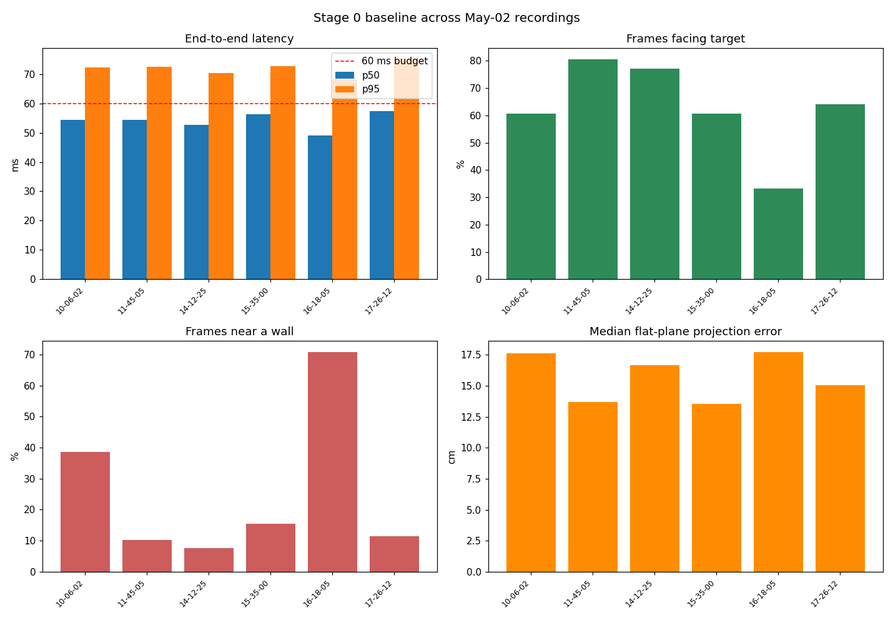
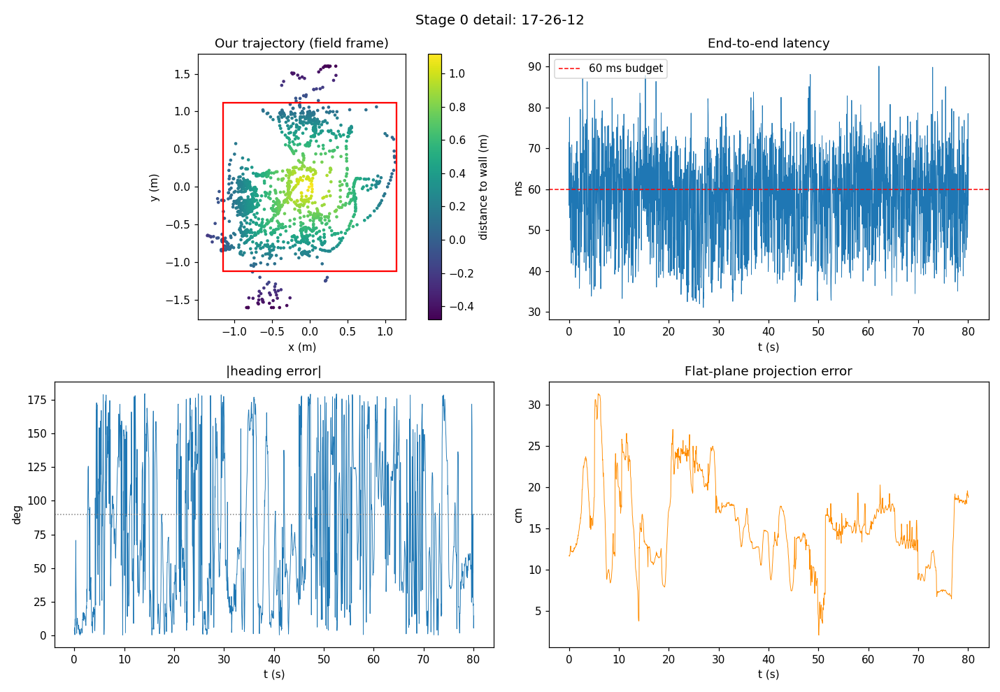

# Stage 0 Control Baseline: Mrs Buff MK3 (May 2 2026)

This report measures the current control performance from the May 2 2026 event recordings, before any
controller changes. It establishes the baseline the control improvement plan
(`control_improvement_plan.md`) needs: how bad is the latency, how reliable is perception, how much do we
overshoot into walls, and how much of that overshoot is explained by the flat-plane projection error.

All numbers come from the existing Jetson recordings in `data/recordings/`. Nothing was re-run (laptop
results differ from the Jetson). The analyzer is `playground/control_stage0/stage0_metrics.py`.

## Method

- Source: the six `auto_battlebot_main_2026-05-02_*_repaired.mcap` recordings (diagnostics + markers, no
  camera images).
- Each metric is computed over the autonomous match window only (first auto-engaged frame to the last
  auto to manual switch), matching `scripts/mcap_auto_percentage.py`. The 10-06-02 recording has no
  autonomous frames (a setup/test session) and is analyzed in full, flagged separately.
- Latency is the end-to-end pipeline latency already logged (`runner/pipeline/latency_ms`), measured from
  the camera frame timestamp. It covers perception and compute only. The Crossfire link (~20 ms) and the
  ESC/mechanical tail are not in the recording and must be measured on the bench.
- Wall distance uses the arena size recovered from the field border marker edge lengths. Projection error
  uses the camera pose in the field frame (from `/tf`) and an assumed keypoint height of 6 cm.

## Baseline numbers



| Fight (time) | Auto window | Latency p50 / p95 (ms) | Facing target | Near wall | Proj. error median | Near-wall error alignment |
| --- | --- | --- | --- | --- | --- | --- |
| 11-45-05 | 74.0 s | 54.5 / 72.4 | 80.6% | 10.3% | 13.7 cm | +0.49 |
| 14-12-25 | 181.7 s | 52.7 / 70.5 | 77.1% | 7.7% | 16.7 cm | +0.81 |
| 15-35-00 | 57.1 s | 56.3 / 72.8 | 60.7% | 15.4% | 13.6 cm | +0.78 |
| 16-18-05 | 123.5 s | 49.0 / 68.3 | 33.1% | 70.9% | 17.7 cm | +0.77 |
| 17-26-12 | 80.1 s | 57.4 / 75.1 | 64.1% | 11.5% | 15.1 cm | +0.52 |
| 10-06-02 (no auto, full) | 471.7 s | 54.4 / 72.3 | 60.7% | 38.7% | 17.6 cm | +0.61 |

Alignment is the dot product of the projection-error direction with the outward normal of the nearest
wall, averaged over near-wall frames. +1 means the error points straight into the wall.

## Findings

### 1. Latency is at or over budget

Median end-to-end latency is 49 to 57 ms across all recordings, with p95 of 68 to 75 ms. The 60 ms budget
is exceeded at p95 in every fight. The dominant stages are the robot mask model (~19-21 ms p50) and the
keypoint model (~10 ms p50). This is before adding the ~20 ms Crossfire link and the ESC/mechanical tail,
so the true actuation latency is meaningfully higher. Latency compensation is justified by the data.

### 2. We spend a lot of time against the wall

Near-wall time ranges from 7.7% to 70.9% of frames. The two high values are the 16-18-05 fight (70.9%,
the John Undercutter flip where the robot was pinned/recovering) and the 10-06-02 setup session (38.7%).
Even in clean fights it is 8-15%. This is the overshoot problem quantified.

### 3. The flat-plane projection error is large and points into the wall

This is the headline result. The keypoint projection assumes every robot lies flat on the field plane,
but the camera sits only ~0.5-0.7 m above the plane, so a robot with real height is placed at a biased
position. Median position error is 13-18 cm (p95 up to 39 cm), which is comparable to the 22 cm robot
length.

Crucially, during near-wall frames the error vector points into the contacted wall (alignment +0.49 to
+0.81 in every fight). The mechanism: the perceived position sits inward of the truth, so the controller
thinks it has more room than it does and drives into the wall. This is strong, consistent evidence that
height compensation would reduce wall collisions. See the per-fight detail plots, e.g.:



The trajectory panel (coloured by distance to the nearest wall) shows the robot repeatedly reaching the
red field boundary; the projection-error panel shows the 10-30 cm bias sustained throughout.

### 4. Perception reliability cannot be measured cleanly from these recordings

The `using_previous_robots` cache-substitution signal is 0% in every fight, and the opponent marker is
present 77-100% of frames. Both overstate reliability: the temporal filter holds an opponent's last pose
when the model fails to detect it, so a held/coasted pose looks identical to a fresh fix. The markers do
not carry `is_stale`, and the raw detection state was not logged at the time.

This is why the new forward-looking logs were added (they only affect future Jetson recordings):

- `runner/perception` counts of live (non-stale) vs total opponents.
- `yolo_seg_robot_blob_model` raw class per detection before it is collapsed to OPPONENT/HOUSE_BOT, to
  expose the mislabel/drop rate (an opponent classified as one of our robots is dropped).
- Opponent label added to `/robot_markers` text.

## Per-fight detail plots

- `assets/detail_11-45-05.png`
- `assets/detail_14-12-25.png`
- `assets/detail_15-35-00.png`
- `assets/detail_16-18-05.png`
- `assets/detail_17-26-12.png`
- `assets/detail_10-06-02.png`

Each shows four panels: trajectory coloured by wall distance, end-to-end latency, heading error, and
flat-plane projection error.

## Reproduce

```bash
source scripts/activate_python.sh
python playground/control_stage0/stage0_metrics.py \
    data/recordings/auto_battlebot_main_2026-05-02_*[0-9]_repaired.mcap \
    --plots docs/experiments/control_improvement/assets
```

Tunable thresholds: `--keypoint-height` (default 0.06 m), `--wall-contact-margin` (default 0.11 m),
`--contact-distance` (default 0.15 m). Add `--csv` for a per-tick dump.

## Next steps

1. Build the fast headless 2D sim with latency, ESC deadzone, friction, and replayed opponent
   trajectories (Stage 1 of the control plan).
2. Wire up `lookahead_time` to forward-predict both robots over the measured latency (Stage 2).
3. Add height compensation to the keypoint projection and re-measure wall-contact rate against this
   baseline. The projection-error numbers above are the predicted upside.
4. On the next Jetson recordings, re-run this analyzer to get the true perception-reliability and
   opponent mislabel rates now that the forward-looking logs are in place.

## Notes moved from code comments (2026-11-15)

- `training/model_eval/perception_reliability.py`:

  ```text
  Measure opponent-track reliability from a playback MCAP recording.

  Stage 0 instrumentation for the control-improvement plan. From a recording (a real Jetson SVO
  replayed in playback, or a live run), report how often a live (non-stale) opponent track is
  available and how long the track is lost at a time. This sets how hard the predictor must work:
  it coasts through the measured dropout gaps, so the gap-length distribution bounds the horizon.

  Source data is the `perception` diagnostics subsection the runner emits once per tick
  (their_count_total, their_count_live, our_present_live; src/runner.cpp), plus the `jump_reject`
  events the FrameId assigner logs. Any recording carrying `/diagnostics` (post 2026-06-19) works
  with no re-instrumentation. The message stamp is the camera frame stamp, so dropout durations
  are real time even under free-run playback.

  Metrics:
    - opponent validity: % of ticks with a live (non-stale) opponent (their_count_live > 0)
    - our-robot validity: % of ticks with a live OUR_ROBOT_1 (our_present_live > 0)
    - opponent dropout gaps: run-lengths of consecutive ticks with no live opponent (frames + ms)
    - our-robot dropout gaps: run-lengths of consecutive ticks with no live OUR_ROBOT_1 (frames + ms).
      These bound the keypoint-override decay `hold_window` in docs/robot_filter_decay_plan.md:
      if our-robot gaps are short, holding the "ours" identity across them is cheap.
    - track churn: jump_reject events per second (the FrameId assigner refusing a far reassignment)

  Not yet measured: true track-ID-switch rate. The diagnostics carry opponent counts, not per-slot
  identity, so a physical robot swapping FrameId slots is not directly observable. jump_reject rate
  is the available proxy. Exact switch tracking needs a small addition to the perception diagnostics
  block (log the live THEIRS FrameId set); see docs.

  Usage:
      source scripts/activate_python.sh
      python training/model_eval/perception_reliability.py         data/recordings/auto_battlebot_experiment_playback_2026-06-20_00-15-08.mcap         --csv out/perception.csv --plot out/perception.png
  ```

