# Opponent filter evaluation, 2026-10-15

Plan: `docs/plans/opponent_motion_estimation_plan.md`, steps 4 and 5. The 6-state opponent filter
(`[px, py, vx, vy, theta, omega]`, `KalmanMotionEstimator` opponent arm) is scored against
AprilTag truth, tuned, and replayed through NHRL May and MassD matches against `HOLD`.

## Data

The plan called for apartment-floor recordings with a tag on Mrs Buff Mk3. Those do not exist
yet, so the ground truth here is the two 2026-10-15 Mr Stabs Mk2 sysid sessions, with Mr Stabs
standing in for an opponent:

| Session | Role | Length | Measurements (30 Hz) | Truth-valid share |
| --- | --- | --- | --- | --- |
| `2026-10-15_00-29-00` | tuning | 461 s | 12,637 | 89% |
| `2026-10-15_00-20-58` | holdout | 306 s | 6,853 | 62% |

- **Measurements:** the deployed pose engine (`yolo26l-pose_all_keypoints_2026-09-25`) on every
  video frame (`detect_robot_yolo.py`), front and back keypoints projected onto the floor with each
  session's tag-fitted calibration, decimated to 30 Hz. Median error against truth is 8.3 mm on the
  tuning session (p90 20.5 mm) and 3.7 mm on the holdout. Heading error is 4.9 and 1.9 degrees
  median.
- **Truth:** the tag-only smoother bundles (`smooth_tag_poses.py` without `--yolo`), so no YOLO fix
  is ever scored against itself. Truth is trusted only within 50 ms of an accepted tag detection
  and while the robot is upright.
- **Timing:** each measurement arrives 63 ms after its shutter, coast runs every 10 ms, and the
  estimate renders at now + 52 ms (the plant `delay_s`), so a fresh estimate is already a 115 ms
  prediction.

Mr Stabs is a hard target for a constant-velocity model. The sysid maneuvers are stick steps,
stops and spins: acceleration p90 is 9.4 m/s², velocity changes by 0.37 m/s (median) over 0.35 s,
and yaw rate reaches 31 rad/s (p99) on the tuning session.

Arms:

- `hold`: the last measurement, no prediction. Production today.
- `kalman4`: the previous 4-state arm: same translation filter, 0.2 s coast, covariance frozen
  past the horizon, and heading from the last measurement or the velocity direction while stale.
- `phase1`: the 6-state filter with the tuned config below.

Scripts: `playground/opponent_prediction/evaluate_opponent_prediction.py` (report, grid),
`plot_dropout_samples.py` (figures), `fit_opponent_sensing_model.py`, `run_replays.py` and
`compare_replays.py`. All run the Python mirror, which the C++ golden-fixture test holds to 1e-6.

## Tuning

Grid over 480 rows on the tuning session, with 0.4 s dropouts every 3 s added so the 0.35 s horizon
has samples: `opponent_accel_psd` 3 to 1000, `opponent_yaw_accel_psd` 10 to 1000,
`opponent_heading_sigma_rad` 0.05 to 0.25, `opponent_position_sigma_m` 8 to 30 mm. The objective
sums normalized median and p90 position error at 0 and 0.35 s, median heading error at both, the
2-sigma coverage miss on position and heading, and the share of measurements the gate rejected.

- Heading: `opponent_yaw_accel_psd = 30` and `opponent_heading_sigma_rad = 0.15` win, both interior.
- Position: flat. The top 10 rows span 6.90 to 6.97 across accel PSD 10 to 300 and position sigma
  8 to 20 mm. PSD 3 calibrates position coverage best (0.98) but rejects 0.1 to 0.6% of
  measurements at the gate and loses 10 mm of fresh p90, so `opponent_accel_psd` keeps 30.
  `opponent_position_sigma_m = 0.012`.
- Coast horizon: swept separately, below. `opponent_max_coast_s = 0.1`.

### Coast horizon

Position error p50 / p90 (mm) on the tuning session, natural gaps, by time since the last
measurement arrived. The sweep ran at the default 30 mm position sigma; at the tuned 12 mm the
0.1 s row becomes the `phase1` row in the results below:

| Horizon | 0 | 0.1 s | 0.2 s | 0.35 s | 0.43-1.2 s |
| --- | --- | --- | --- | --- | --- |
| none (filtered pose held) | 25 / 176 | 52 / 282 | 72 / 365 | 73 / 515 | 98 / 499 |
| 0.05 s | 22 / 115 | 50 / 202 | 48 / 344 | 41 / 596 | 50 / 495 |
| 0.1 s | 21 / 87 | 49 / 179 | 63 / 312 | 98 / 631 | 128 / 486 |
| 0.2 s (shared `max_coast_s`) | 21 / 86 | 40 / 178 | 75 / 309 | 244 / 623 | 296 / 522 |
| 0.3 s | 21 / 86 | 40 / 176 | 117 / 460 | 295 / 681 | 447 / 696 |

Past about 0.1 s of extrapolation the velocity is more often wrong than right on this robot: it
stops and reverses faster than a constant-velocity model can follow. 0.1 s keeps all of the fresh
gain and cuts the 0.35 s median from 244 to 98 mm. The holdout is flat across 0.1 to 0.2 s. A
decaying-velocity coast (velocity time constant 0.05 to 0.4 s) landed on the same trade curve
and was not adopted.

## Results

### Position

p50 / p90 (mm) by time since the last measurement arrived, natural gaps:

| Session | Arm | 0 | 0.1 s | 0.2 s | 0.35 s | 0.43-1.2 s | 1.2-3.5 s |
| --- | --- | --- | --- | --- | --- | --- | --- |
| tuning | hold | 24 / 165 | 52 / 272 | 65 / 373 | 59 / 515 | 87 / 506 | 74 / 262 |
| tuning | kalman4 | 21 / 86 | 44 / 192 | 71 / 328 | 246 / 501 | 301 / 537 | 288 / 745 |
| tuning | phase1 | 20 / 80 | 50 / 178 | 64 / 316 | 105 / 550 | 122 / 488 | 161 / 470 |
| holdout | hold | 4 / 84 | 35 / 213 | 29 / 278 | 37 / 342 | 43 / 576 | 101 / 609 |
| holdout | kalman4 | 5 / 47 | 33 / 167 | 31 / 217 | 52 / 274 | 54 / 410 | 163 / 545 |
| holdout | phase1 | 6 / 46 | 32 / 146 | 32 / 204 | 50 / 287 | 46 / 455 | 106 / 537 |

With 1 s dropouts every 8 s added (the 0.35 s bin is then mostly synthetic gaps), the 0.35 s
median is 110 mm for `phase1` against 90 mm for `hold` on the tuning session, and 27 against
27 mm on the holdout.

- Fresh and at 0.1 s the filter halves the p90 against `hold` (80 against 165 mm, 178 against
  272 mm on the tuning session).
- At 0.35 s it loses the median to `hold` on the tuning session (105 against 59 mm) and roughly
  ties on the holdout. That bin is small, 167 samples. 104 are straight-line motion, where the
  extrapolation overshoots (112 against 84 mm). 13 are a robot that had already stopped, where it
  overshoots badly (205 against 14 mm).
- Against `kalman4` it wins at 0.35 s and beyond (105 against 246 mm), from the shorter horizon.

By motion class, all horizons, tuning session (position p50 mm / heading p50 deg):

| Arm | still | straight | arcing | spinning |
| --- | --- | --- | --- | --- |
| hold | 7 / 4.7 | 23 / 6.6 | 76 / 12.1 | 35 / 52.5 |
| phase1 | 9 / 5.8 | 19 / 7.2 | 36 / 9.9 | 39 / 31.8 |

### Heading and yaw rate

Heading error p50 / p90 (deg), natural gaps:

| Session | Arm | 0 | 0.1 s | 0.2 s | 0.35 s | 0.43-1.2 s |
| --- | --- | --- | --- | --- | --- | --- |
| tuning | hold | 8 / 38 | 7 / 30 | 3 / 12 | 4 / 9 | 5 / 19 |
| tuning | kalman4 | 8 / 40 | 11 / 175 | 77 / 178 | 172 / 178 | 174 / 178 |
| tuning | phase1 | 8 / 29 | 8 / 28 | 6 / 18 | 7 / 14 | 9 / 29 |
| holdout | hold | 2 / 13 | 6 / 14 | 6 / 24 | 7 / 37 | 7 / 23 |
| holdout | phase1 | 2 / 13 | 6 / 17 | 7 / 28 | 7 / 34 | 6 / 28 |

- The previous arm's "velocity direction while stale" rule is wrong whenever the robot drives
  backwards or slides: 77 to 174 degrees median once stale. The filtered heading fixes that.
- Fresh p90 drops from 38 to 29 degrees against `hold`, and spinning-class heading from 52.5 to
  31.8 degrees median. On the holdout, which barely spins, the filter ties `hold`.
- Yaw rate error: 0.68 rad/s median, 4.4 p90 on the tuning session; 0.12 and 1.8 on the holdout.

### Consistency

| Session | 2σ position | 2σ heading | 2σ yaw rate | Joint NIS (3 dof) | Gate accepted | Flips per 100 |
| --- | --- | --- | --- | --- | --- | --- |
| tuning | 1.000 | 0.941 | 0.925 | 0.37 | 100% | 0.15 |
| holdout | 0.999 | 0.996 | 0.988 | 0.05 | 100% | 0 |

Heading and yaw-rate sigmas mean what they say. The position sigma is conservative: the 2σ
steady-state ring is a few hundred millimetres against 20 mm errors. Two causes. YOLO's position
error is a slowly varying bias rather than frame-to-frame jitter, so innovations are small (NIS
0.05 to 0.4 against 2 to 3 expected). And the 115 ms render lead multiplies a velocity variance
sized for this robot's accelerations. Lowering the accel PSD to fix coverage costs gate
acceptance. The policy normalizes position sigma by 0.1 m and caps it at 1, so it will mostly read
a capped sigma. Fixing this needs a bias state or a lower-latency render, not a different number.

### Dropouts

Each figure withholds every measurement inside one gap and plots the top-down path with the
filter's 2σ, position error against time into the gap, heading, and yaw rate. Summary figures
take the median over every gap in the session (one every 8 s).

Median position error inside the gap (mm), median heading error inside the gap (deg), and median
position error 0.15 to 0.5 s after the gap ends (mm), over every periodic gap:

| Session | Gap | phase1 | kalman4 | hold |
| --- | --- | --- | --- | --- |
| tuning | 0.2 s | 28, 8.6°, 21 | 26, 9.4°, 21 | 33, 8.7°, 23 |
| tuning | 1 s | 89, 11.6°, 24 | 94, 15.6°, 23 | 95, 13.0°, 31 |
| tuning | 3 s | 247, 22.7°, 26 | 260, 33.6°, 35 | 242, 25.5°, 29 |
| holdout | 0.2 s | 11, 4.3°, 13 | 13, 2.2°, 12 | 9, 2.0°, 12 |
| holdout | 1 s | 17, 3.8°, 15 | 18, 4.0°, 14 | 16, 3.6°, 15 |
| holdout | 3 s | 33, 6.1°, 7 | 35, 6.5°, 7 | 32, 6.4°, 4 |

Past the 0.1 s horizon the filter holds, so for long gaps its position is the held point and it
tracks `hold` within a few millimetres. What it adds through a long gap is a heading that does not
swing (22.7 against 33.6 degrees for `kalman4` over 3 s) and a sigma that grows, which lets the
gate take the reacquisition at once. Before the covariance kept propagating past the horizon, the
first measurements after a 0.5 s gap were rejected until `reinit_after_rejects` ran out.

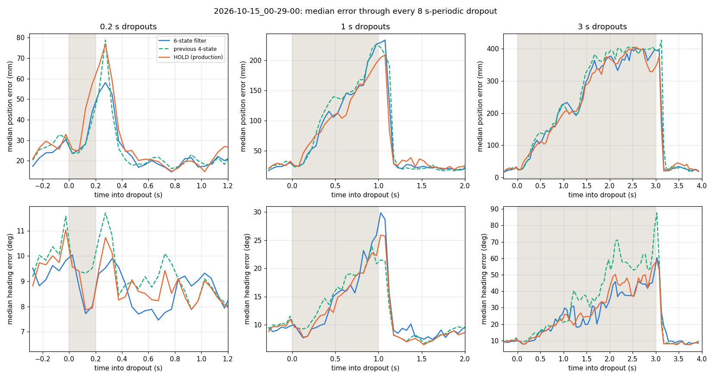
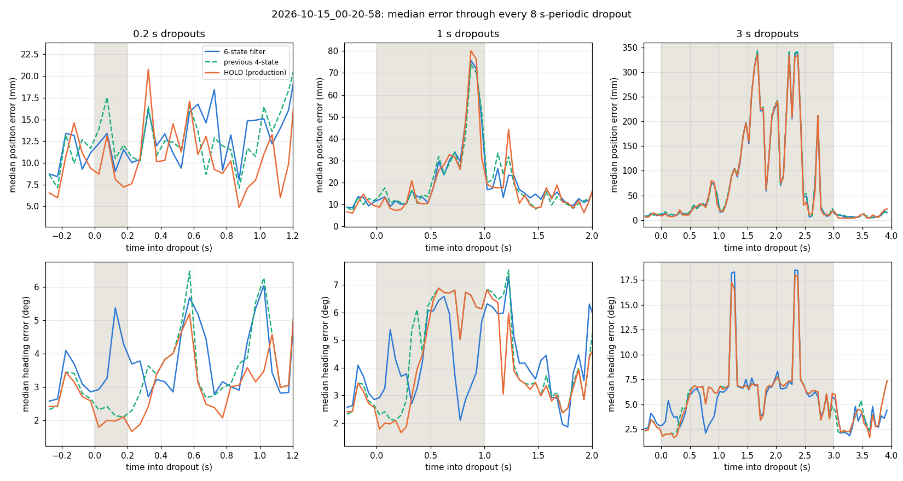

Single gaps, tuning session:

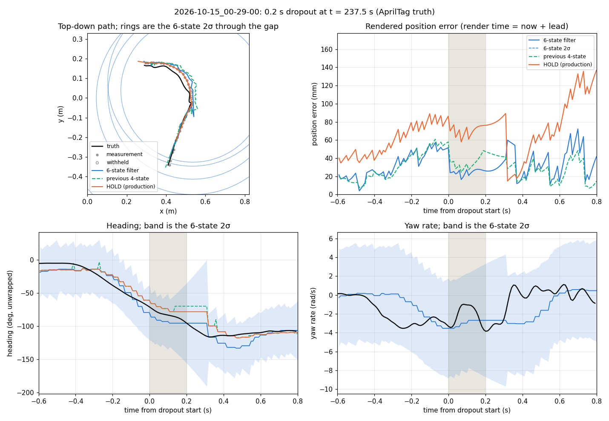
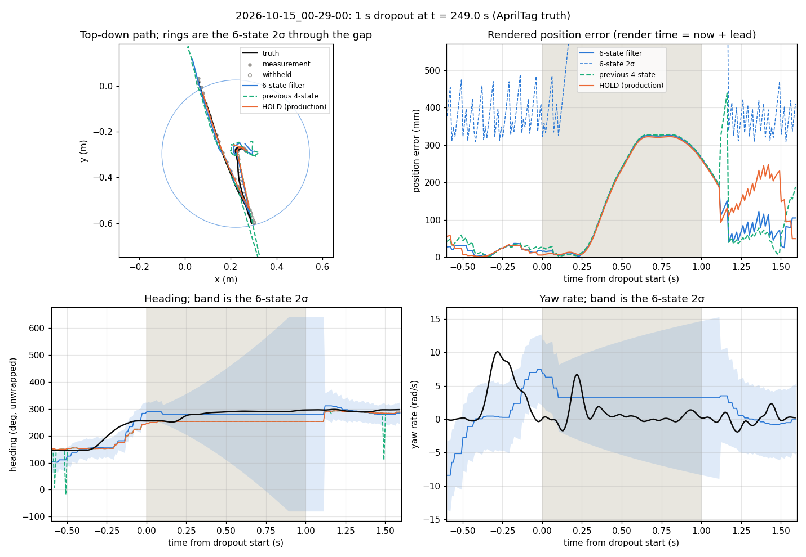
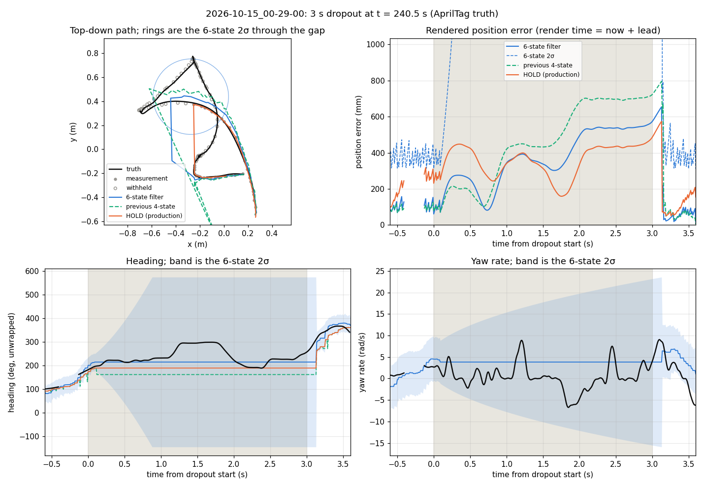

Single gaps, holdout session:

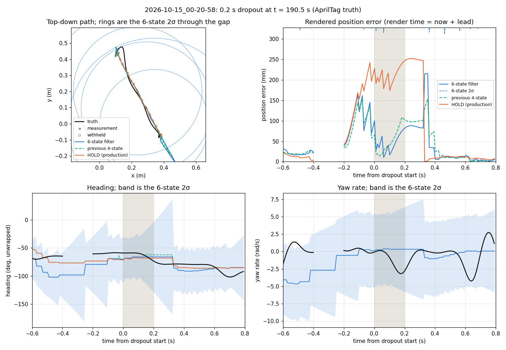
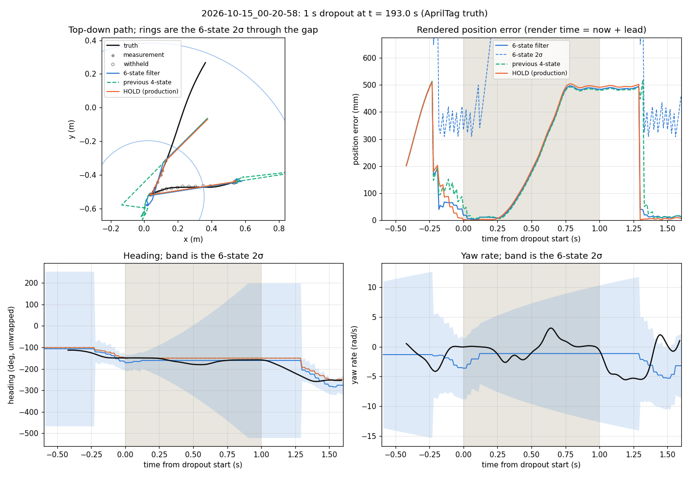
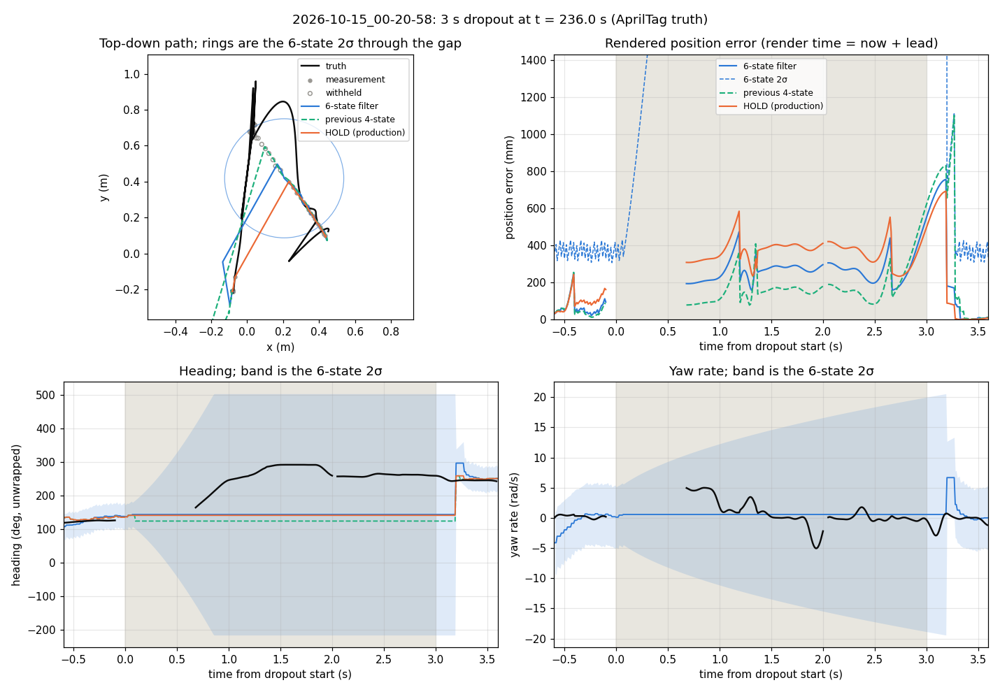

## Match replays (plan step 4)

Eight NHRL May and MassD recordings, each replayed twice through the release binary in real-time
playback (`run_replays.py`), once with `opponent_mode = "HOLD"` and once with `"KALMAN"`, Mrs Buff
Mk3 as our robot. MassD `09-05-14` never produced an opponent measurement and is left out.

| Recording | Opponent measurements | Extra gate rejects | Track reinits (K / H) | Heading flips | Heading reinits | Identity swaps | Fresh-opponent share (K / H) |
| --- | --- | --- | --- | --- | --- | --- | --- |
| NHRL 11-45-08 | 1,431 | 7 | 0 / 0 | 53 | 9 | 0 | 0.55 / 0.56 |
| NHRL 14-12-27 | 968 | 0 | 0 / 0 | 15 | 3 | 0 | 0.12 / 0.12 |
| NHRL 16-18-07 | 4,008 | 16 | 1 / 1 | 48 | 11 | 0 | 0.69 / 0.65 |
| NHRL 17-26-14 | 4,177 | 25 | 2 / 1 | 87 | 19 | 0 | 0.66 / 0.66 |
| MassD 11-17-26 | 1,325 | 15 | 0 / 0 | 113 | 21 | 0 | 0.37 / 0.37 |
| MassD 13-20-08 | 3,230 | -9 | 1 / 1 | 27 | 4 | 0 | 0.60 / 0.60 |
| MassD 15-21-23 | 1,874 | 0 | 3 / 2 | 37 | 6 | 0 | 0.49 / 0.48 |

"Extra gate rejects" is KALMAN minus HOLD `num_gated`; the counter includes the our-robot EKF,
which is the HOLD figure. The filter gates out 0 to 25 opponent measurements per match, at most
1.1% of them. No identity swaps in either mode, the fresh-opponent share moves by at most 4
points, and navigation lost our robot on the same share of ticks in both modes. The heading flip
rate against the filtered heading reaches 8.5% on MassD `11-17-26`, whose opponent the keypoint
model orients inconsistently; 21 runs of three flips re-initialized the heading there.

### Against later measurements

The plan's metric for data without truth: each KALMAN replay's opponent measurements run through
the mirror with 1 s dropouts every 8 s, and every rendered estimate is scored against the
measurement nearest its render time (`compare_replays.py`). Position p50 / p90 (mm):

| Recording | Arm | 0 | 0.1 s | 0.35 s |
| --- | --- | --- | --- | --- |
| NHRL 11-45-08 | hold | 16 / 96 | 75 / 254 | 221 / 407 |
| | phase1 | 19 / 61 | 54 / 164 | 207 / 335 |
| NHRL 14-12-27 | hold | 9 / 29 | 9 / 37 | 10 / 113 |
| | phase1 | 17 / 42 | 16 / 53 | 33 / 65 |
| NHRL 16-18-07 | hold | 5 / 20 | 7 / 28 | 11 / 36 |
| | phase1 | 9 / 34 | 11 / 41 | 12 / 43 |
| NHRL 17-26-14 | hold | 32 / 105 | 49 / 171 | 84 / 340 |
| | phase1 | 31 / 82 | 51 / 136 | 79 / 281 |
| MassD 11-17-26 | hold | 25 / 114 | 88 / 217 | 51 / 387 |
| | phase1 | 36 / 116 | 88 / 257 | 112 / 319 |
| MassD 13-20-08 | hold | 22 / 83 | 51 / 200 | 138 / 537 |
| | phase1 | 23 / 71 | 46 / 157 | 79 / 406 |
| MassD 15-21-23 | hold | 6 / 68 | 13 / 125 | 10 / 275 |
| | phase1 | 9 / 49 | 17 / 118 | 12 / 275 |

The truth here is the measurement stream itself, which `hold` repeats with a lag, so this metric
favors `hold` wherever the opponent sits still (14-12, 16-18) and on heading wherever the filter
correctly refuses a flipped measurement. Against moving opponents (11-45, 17-26, 13-20) the filter
cuts the p90 at 0 and 0.1 s by 15 to 35%. Position NIS on match measurements is 0.02 to 0.5 at
every sigma from 10 to 120 mm, so cage keypoints are no noisier frame to frame than the sysid
ones and the 12 mm sigma does not over-gate.

The NHRL 17-26 opponent is a full-body spinner at about 20 rad/s. The filter carries an 18 rad/s
yaw rate through a 1 s gap with a 2σ band that covers it; the heading itself falls behind.

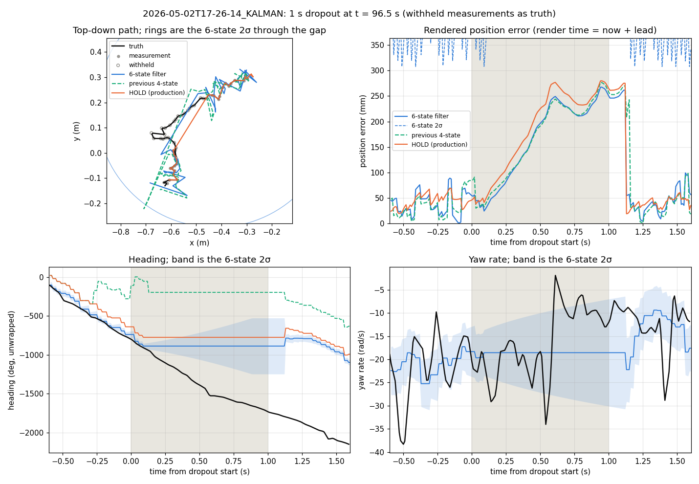
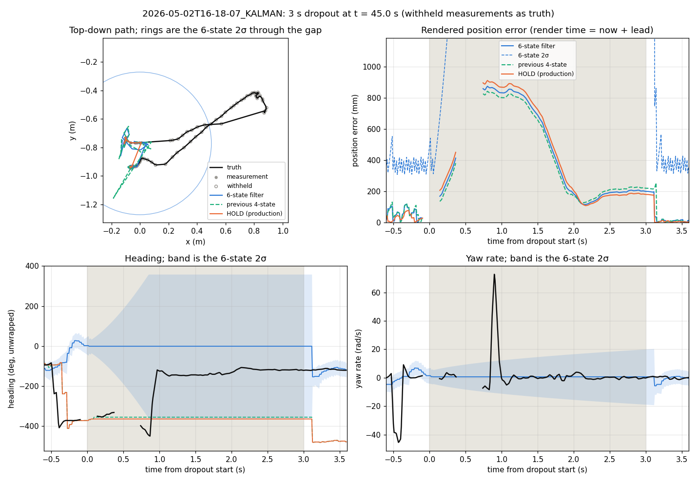
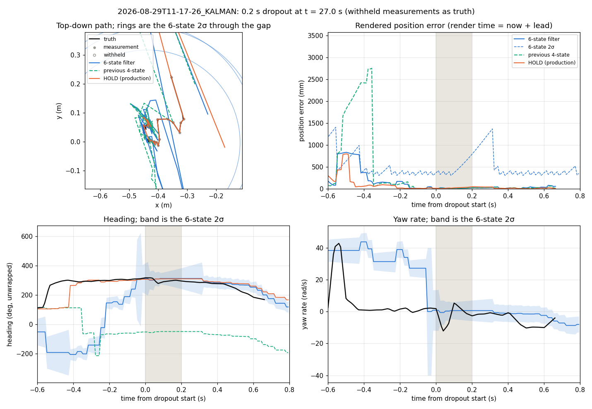
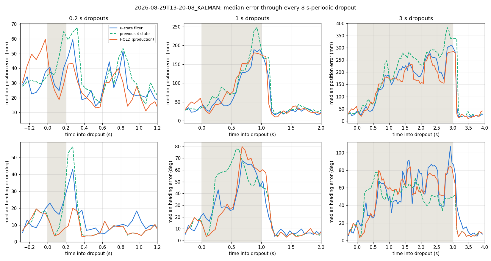

Replays ran on the laptop in real time. Playback drops about one frame per 0.5 s for pacing, and
the `CameraFollowingClock` steps back a few milliseconds when a new frame re-anchors it, which
logs "Coast span is -0.00x s" warnings now that opponent tracks commit every tick. Neither
happens with the live system clock.

## Measurement model

`playground/opponent_prediction/sensing_model_opponent.toml`, the opponent half of the RL plan's
`sensing_model.toml`: position and heading noise and flip rate by speed bin from the sysid truth,
dropout runs and gaps from the sysid sessions and from the match replays, and the 63 ms nominal
latency. It is fitted on Mr Stabs; Mrs Buff Mk3 and unseen opponents will have their own heading
error and flip rate.

## Verdict

The plan's gate: phase 1 beats `hold` and `kalman4` at 0.1 and 0.35 s.

- Against `kalman4`: passes. Position ties at 0.1 s (50 / 178 against 44 / 192 mm) and wins at
  0.35 s (105 against 246 mm); heading wins at every horizon past fresh, by up to 165 degrees.
- Against `hold`, heading: passes or ties. Fresh p90 38 to 29 degrees, spins 52.5 to 31.8 degrees.
- Against `hold`, position at 0.1 s: passes on p90 (178 against 272 mm), ties on the median.
- Against `hold`, position at 0.35 s: fails on the tuning session (105 against 59 mm median),
  ties on the holdout (50 against 37 mm natural, 27 against 27 mm with 1 s gaps). The misses are
  straight-line overshoot and robots that had stopped, not arcs.

Step 4 passed: no identity swaps and no downstream loss in any replay.

Decision: `opponent_mode = "KALMAN"` in `config/_common.toml` (step 6). The 0.35 s position miss
is limited by the 0.1 s coast horizon, every other comparison is a win or a tie, and
`RlPolicyNavigation` needs the yaw rate and sigmas that `HOLD` cannot give. Reverting is that one
line.

Phase 2 (step 7) is not triggered. It is for arc and lateral errors at 0.35 s; the arcing class
is where the filter already does best (36 against 76 mm median), and the 0.35 s misses would not
change under a body-frame model, which extrapolates a stopping robot just as far.

## Next steps

- Record the apartment-floor sessions with a tag on Mrs Buff Mk3 (RL plan section 9) and rerun
  `evaluate_opponent_prediction.py` with that opponent, to replace the Mr Stabs stand-in and get a
  per-label flip rate.
- Add MassD `11-17-26`'s opponent to `heading_blind_labels` if it gets its own label: an 8.5% flip
  rate is mostly noise.
- A position bias state, or rendering at a shorter lead, would bring the position sigma's
  coverage down from 1.00 toward 0.95; the policy reads a capped position sigma until then.

## Limitations

- One robot, one floor, one camera rig. The keypoint model has seen a lot of Mr Stabs, so heading
  error and flip rate here are a floor for what an unseen opponent will show.
- No contact: no shoves, wall pins, or two robots crossing. Identity swaps and the renderer wall
  stop are covered by the replays and the unit tests, not by truth.
- The tuning objective's weights are a judgment call. The heading terms are stable under any
  weighting tried; the position terms are flat.
