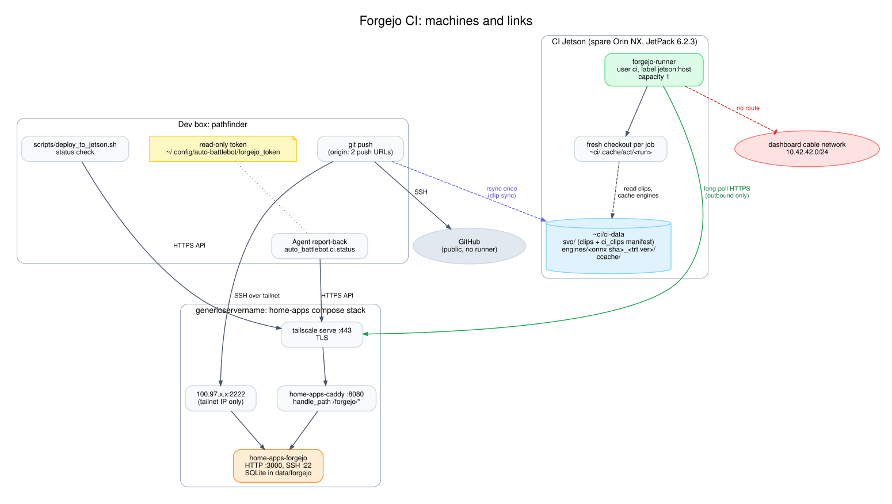
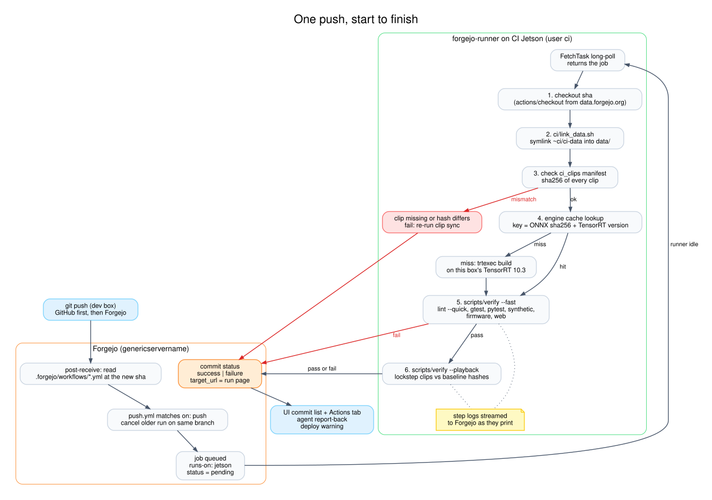
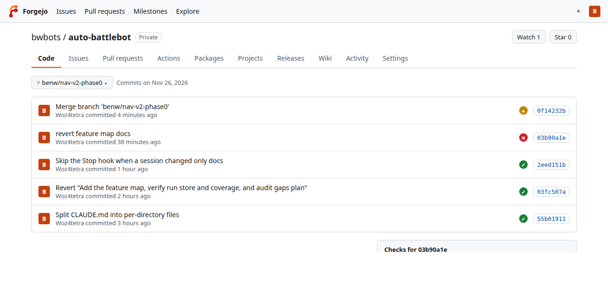
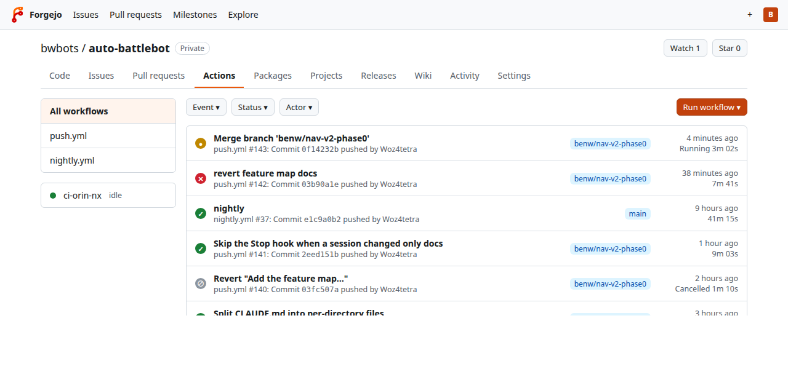
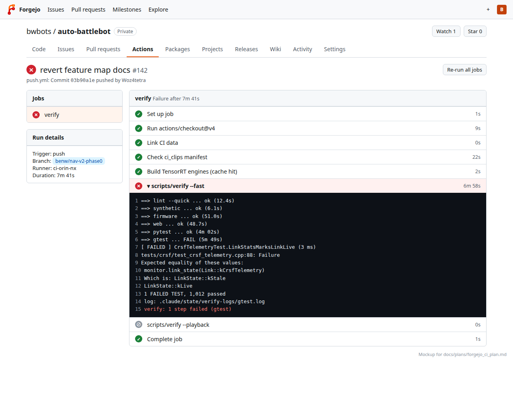
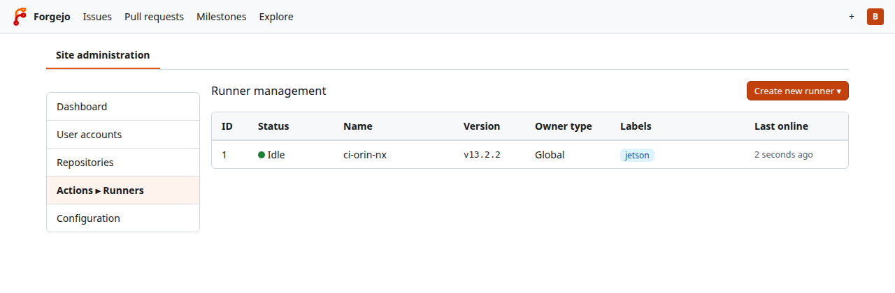
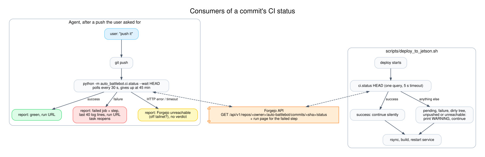

# Forgejo CI plan

This plan builds phase 5 of `docs/plans/verification_plan.md`: a tailnet-only Forgejo on
genericservername, a runner on the spare Orin NX, and status checks that the deploy script and the
agent read. It covers WP-V12, WP-V13 and WP-V14. The decisions behind it are Q8, Q15, Q22, Q23,
Q28 to Q31 and Q38 to Q43 in the verification plan's decision log. This plan does not revisit them.

GitHub stays the public source of truth and gets no runner. Each `git push` also goes to Forgejo,
which runs C++ and robot-side Python on the Jetson and everything else on megamind ("CI split").
Forgejo runs `.forgejo/workflows/*.yml` on the Jetson and stores a pass or fail status on the
commit.

## Status (2026-11-27)

WP-V12 is up except the landing tile and README row: Forgejo 17.0.2 serves `/forgejo/`, SSH on
2222 takes pushes, and `origin` pushes to GitHub and Forgejo. compute-1 runs the `jetson` runner
(`auto-battlebot-compute-1`) under systemd, `ci` egress-limited and tagged `tag:ci`.

Code written: `verify --target`/`--nightly`, the `jetson` and `gpu` markers, `scripts/lint
--strict/--only/--skip/--protocol-dump`, `verify.ci_clips`, `verify.ci_engines` with
`ci/build_engines.sh`, `push.yml`, `nightly.yml`, `auto_battlebot/ci/status.py`, the deploy
warning, and `auto_battlebot/ci/relay.py`. The playback profiles list the `aarch64_sm87` engines
beside the x86 ones. Still on boxes and accounts: the megamind runner, Jetson playback baselines,
the relay container and its GitHub token, the `main` ruleset, the landing tile.

- The status client reads the forge URL and repo from `~/.config/auto-battlebot/forgejo.toml`, so
  the tailnet hostname stays out of the code.
- The relay is one stdlib file with no `auto_battlebot` imports, so the home-apps container runs
  it with a stock Python image and the file mounted.
- `ci/forgejo-runner.service` is the runner unit for both boxes; megamind adds
  `ci/forgejo-runner-x86-limits.conf` as a drop-in.

Facts this plan depends on, checked on 2026-11-26:

- home-apps runs as compose project `home-apps` from `~/home-app` on genericservername. Caddy
  (`home-apps-caddy`, host port 23100) is the only `tailscale serve` target. Apps mount at
  sub-paths with `handle_path`.
- The only host port besides Caddy's is `minecraft-server` on 25565. Forgejo SSH on 2222 becomes
  the second.
- genericservername: 8 cores, 23 GB RAM, 366 GB free on `/`.
- `scripts/install_jetson_ci.sh` already installs the toolchain on a Jetson: ZED SDK, LLVM,
  OpenCV with CUDA, the venv, PyTorch, Foxglove SDK, mcap CLI, taplo, PlatformIO and Node.
- Playback clips come from three recordings: 2.44 GB in total (`2026-05-02T10-06-06` 801 MB,
  `T11-45-08` 1,005 MB, `T14-12-27` 632 MB). `data/models/` holds 1.1 GB on the dev box.
- Latest releases: Forgejo 17.0.2 (15.0.12 was patched the same week) and forgejo-runner 13.2.2.

## How it fits together



There are three machines and one rule for each link:

- **Dev box to Forgejo.** `git push` writes to two push URLs on `origin`: GitHub first, then
  Forgejo over SSH on genericservername's tailnet IP, port 2222. API calls (agent report-back and
  the deploy check) go over HTTPS through `tailscale serve` and Caddy.
- **Runner to Forgejo.** The runner long-polls Forgejo over HTTPS and only makes outbound
  connections. Nothing on the Jetson listens for Forgejo, so the Jetson needs only Tailscale and
  no open ports.
- **Runner to the robot network.** There is no route. The `ci` user cannot reach
  `10.42.42.0/24`.

## How one push runs



1. `git push` updates GitHub, then Forgejo. If the Forgejo push fails because the dev box is off
   the tailnet, git prints the error and exits non-zero after GitHub already took the push. Run
   `git push` again once back on the tailnet.
2. Forgejo reads `.forgejo/workflows/` at the pushed sha. `push.yml` matches `on: push`. A new push
   to the same branch cancels the older run, which is Forgejo's default for `on: push`.
3. Forgejo queues one job with `runs-on: jetson` and sets the commit status to pending.
4. The runner is idle at capacity 1, gets the job on its next poll, and runs the steps as `ci` in
   a fresh directory:
   1. Check out the sha with `git fetch --depth=1`.
   2. `ci/link_data.sh`: symlink `~ci/ci-data/svo` and `~ci/ci-data/models` into `data/` and
      `~ci/venv` to `venv/`, then point the venv's editable install at this checkout.
   3. `python -m auto_battlebot.verify.ci_clips check`: sha256 of every clip against the
      committed manifest. A missing or changed clip fails the job with "run clip sync".
   4. `ci/build_engines.sh`: look up each engine in `~ci/ci-data/engines/` under the key
      `<onnx sha256>_trt<version>`. On a miss, build it with this box's TensorRT 10.3 and store it.
   5. `scripts/verify --fast`
   6. `scripts/verify --playback`, which is skipped if step 5 failed.
5. The runner streams each step's log to Forgejo while it prints, then reports the result.
   Forgejo sets the commit status to success or failure with a link to the run page.
6. The UI, `scripts/deploy_to_jetson.sh` and the agent read that status.

Nightly runs `nightly.yml` from `main` with the same setup steps, then `scripts/verify --realtime`
and, once nav plan WP-14 lands, `--sim`. Forgejo only runs `schedule` workflows from the default
branch, so a nightly change needs to be merged to `main` before it runs.

## What the UI looks like

These are mockups drawn for this plan, not screenshots of a running instance. The layout follows
Forgejo's Actions pages. The commit messages are real; the statuses, timings and test failure are
invented. Real timings come from WP-V13.

**Commit list.** Each commit gets a status icon. Clicking it opens the check list, and Details
links to the run.



**Actions tab.** Every run of every workflow, newest first, filterable by workflow, event, status
and actor. "Run workflow" starts a `workflow_dispatch` workflow by hand.



**A failed run.** Jobs are on the left and steps on the right. The failed step opens with its log.
Later steps show as skipped. Re-run all jobs runs the same sha again. The agent's report-back
links to this page.



**Runner admin.** Site administration > Actions > Runners shows whether the Jetson is idle,
active or offline, plus its version and labels.



## WP-V12: Forgejo on genericservername

Done when a push over tailnet SSH lands, `/forgejo/` serves the UI, and the landing page has the
tile.

### Compose service

Add to `~/home-app/docker-compose.yml` and add `forgejo` to Caddy's `depends_on`:

```yaml
  forgejo:
    image: codeberg.org/forgejo/forgejo:17
    container_name: home-apps-forgejo
    restart: unless-stopped
    environment:
      - USER_UID=1000
      - USER_GID=1000
      - FORGEJO__database__DB_TYPE=sqlite3
      - FORGEJO__server__ROOT_URL=https://genericservername.<tailnet>.ts.net/forgejo/
      - FORGEJO__server__HTTP_PORT=3000
      - FORGEJO__server__SSH_DOMAIN=<genericservername-tailnet-ip>
      - FORGEJO__server__SSH_PORT=2222
      - FORGEJO__service__DISABLE_REGISTRATION=true
      - FORGEJO__service__REQUIRE_SIGNIN_VIEW=true
      - FORGEJO__actions__ENABLED=true
      - FORGEJO__repository__DEFAULT_PRIVATE=private
    volumes:
      - ./forgejo/data:/data
    ports:
      - "<genericservername-tailnet-ip>:2222:22"
    expose:
      - "3000"
```

- The volume follows the home-apps `./<app>/data` convention instead of the `data/forgejo` path
  in the verification plan.
- Forgejo keeps its own login. The home-apps `SESSION_SECRET` passcode does not cover it, so the
  service does not get `env_file: .env`.
- Binding to the tailnet IP needs Tailscale up before Docker starts the container. If the bind
  fails at boot, add `After=tailscaled.service` to `deploy/home-apps.service`.
- Pin the major version. Check https://forgejo.org/releases/ for the current LTS line when
  installing, and use that instead of 17 if it is older but still supported.

### Caddy

Add next to the other apps in `caddy/Caddyfile`:

```
redir /forgejo /forgejo/ 301

handle_path /forgejo/* {
	request_body {
		max_size 200MB
	}
	reverse_proxy forgejo:3000 {
		flush_interval -1
	}
}
```

`handle_path` strips `/forgejo`, so Forgejo sees `/`. Its links stay correct because `ROOT_URL`
contains the prefix. `flush_interval -1` keeps live run logs from arriving in chunks. The body
limit covers pushes over HTTP if one is ever needed. Normal pushes use SSH.

### Landing tile and README

- Add a Forgejo card to `caddy/site/index.html` with its own accent. The settings page picks it
  up.
- Add a `/forgejo/` row to the home-apps README table, plus a short "Forgejo SSH 2222" note next
  to the Minecraft port exception.

### First-time setup

```bash
cd ~/home-app && docker compose up -d forgejo caddy
docker exec -u git home-apps-forgejo forgejo admin user create \
  --admin --username <user> --email <email> --random-password
```

1. Log in at `/forgejo/`, change the password, add the dev box's SSH public key.
2. Create an empty private repo `auto-battlebot`.
3. On the dev box:
   ```bash
   git remote set-url --add --push origin git@github.com:Woz4tetra/auto-battlebot.git
   git remote set-url --add --push origin ssh://git@<genericservername-tailnet-ip>:2222/<user>/auto-battlebot.git
   git push origin --all
   ```
   The first `--add --push` keeps GitHub as a push URL. Once any push URL is set, git stops using
   the fetch URL for pushes.
4. Check `git remote -v` shows one fetch URL and two push URLs.

GitHub stays the source of truth. If `forgejo/data` is lost, recreate the repo and push again.
Only the run history is lost, so Forgejo gets no backup job.

## WP-V13: CI Jetson and runner

Done when a push runs `--fast` and `--playback` on the Jetson and the commit turns green.

### Box setup

1. Flash the spare Orin NX to JetPack 6.2.1 / L4T R36.4, the JetPack 6 release the install
   scripts accept and the one the ZED Box Mini runs. Done: `auto-battlebot-compute-1` runs
   R36.4.4, CUDA 12.6, TensorRT 10.3, ZED SDK 5.2.3.
2. Install Tailscale and join the tailnet.
3. Sync the repo with `scripts/deploy_to_jetson.sh <host> --sync-only`, then run
   `scripts/install_jetson_ci.sh` on the box. `ccache` is in `install/jetson_packages.txt` since
   c857b071. A tool still missing after the install is a bug in the install scripts, so fix them
   there and not on the box.
4. Create the `ci` user: no sudo, no SSH keys, no tokens in its home.
5. Confine `ci`'s egress. Jobs run any code pushed to Forgejo, so `ci` reaches Forgejo and the
   public internet (FetchContent, pip, npm) and nothing else: no home LAN, no
   robot network (10.42.42.0/24), no other tailnet device. Put a table of its own in
   `/etc/nftables.d/ci_egress.nft` and include it from `/etc/nftables.conf`. Load it with
   `nft -f` on that file, never by restarting `nftables.service`, whose `flush ruleset` also
   drops the rules tailscaled added. Create the `ci` user first, because nft resolves `skuid`
   names at load:
   ```
   table inet ci_egress {
     chain output {
       type filter hook output priority 0; policy accept;
       meta skuid != "ci" accept
       oifname "lo" accept
       ip daddr 100.97.149.90 tcp dport 443 accept
       ip daddr { 10.0.0.0/8, 172.16.0.0/12, 192.168.0.0/16, 169.254.0.0/16, 100.64.0.0/10 } drop
       ip6 daddr { fc00::/7, fe80::/10 } drop
     }
   }
   ```
   The rules `drop` because the L4T 5.15 kernel is built without `CONFIG_NFT_REJECT`, so nft
   refuses `reject` with "No such file or directory". A blocked connection times out instead of
   failing at once; `curl -m 5` exits 28.
   DNS still works: `ci` asks systemd-resolved on 127.0.0.53, and resolved forwards to MagicDNS as
   its own user.
6. Tag the box `tag:ci` in Tailscale so a job with root on the box still reaches only Forgejo.
   Done 2026-11-27 in the admin console's visual policy editor, which writes grants:
   ```json
   "tagOwners": { "tag:ci": ["autogroup:admin"] },
   "hosts": { "genericservername": "100.97.149.90" },
   "grants": [
     { "src": ["autogroup:member"], "dst": ["*"], "ip": ["*"] },
     { "src": ["tag:ci"], "dst": ["genericservername"], "ip": ["tcp:443"] }
   ]
   ```
   - Definitions, Tags: `ci`. Definitions, Hosts: `genericservername`.
   - The allow-all rule's source went from `*` to `autogroup:member`, which excludes tagged
     devices. Members can still SSH in.
   - Machines, Edit ACL tags: `tag:ci` on compute-1.
   - Checked from compute-1 as `ben`: Forgejo returns 200; megamind:22 and
     genericservername:22 time out.

### Runner

Runner v13 with Forgejo 17 drops `forgejo-runner register`. Site administration, Actions,
Runners, Create new runner shows a UUID and a 40-character token once, and both go into
`config.yml`. Passing that token to `register` fails with "runner registration token not found".

```bash
sudo -u ci -i
cd ~/runner
curl -fLO https://code.forgejo.org/forgejo/runner/releases/download/v13.2.2/forgejo-runner-13.2.2-linux-arm64
sha256sum forgejo-runner-13.2.2-linux-arm64   # compare with the release page
install -m 755 forgejo-runner-13.2.2-linux-arm64 ~/bin/forgejo-runner
~/bin/forgejo-runner generate-config > ~/runner/config.yml
chmod 600 ~/runner/config.yml
```

In `config.yml` set:

```yaml
runner:
  capacity: 1
  timeout: 90m
  labels:
    - jetson:host
  envs:
    CCACHE_DIR: /home/ci/ci-data/ccache
    CMAKE_CXX_COMPILER_LAUNCHER: ccache
    CMAKE_C_COMPILER_LAUNCHER: ccache

server:
  connections:
    forgejo:
      url: https://genericservername.tail291fd.ts.net/forgejo/
      uuid: <UUID from Create new runner>
      token: <token from Create new runner>
```

The runner on compute-1 is named `auto-battlebot-compute-1`. `forgejo-runner daemon --config
~/runner/config.yml` logged "declared successfully" with labels `[jetson]` on 2026-11-27.

- `capacity: 1` lets one job use the whole 16 GB box. Other runs wait in Forgejo's queue.
- `jetson:host` runs steps on the box itself with no container, which keeps CUDA, TensorRT and
  the ZED SDK visible.
- A fresh checkout per job means a full C++ build each time. ccache in `ci-data` keeps that build
  under control. Measure a cold and a warm build and record both in the outcome.

Run the runner as a systemd system unit with `User=ci`, `Restart=always`,
`After=network-online.target tailscaled.service`, `ExecStart=/home/ci/bin/forgejo-runner daemon
--config /home/ci/runner/config.yml`.

### CI data

```
~ci/ci-data/
  svo/NHRL_2026-05-02/*.svo2       the three clip recordings, 2.44 GB
  models/                          ONNX files only, no x86 engines
  engines/<onnx sha256>_trt<ver>/  engines built on this box
  ccache/
```

- **Clip manifest.** New module `auto_battlebot/verify/ci_clips.py` and committed
  `auto_battlebot/verify/ci_clips.json`. `write` hashes every recording that
  `playback_clips.toml` uses. `check` compares the files in `data/` with the manifest. `sync
  <host>` rsyncs missing or changed recordings and ONNX files to `ci@<host>:ci-data/`. Tests go in
  `auto_battlebot/verify/tests/test_ci_clips.py`.
- **Engines.** `ci/build_engines.sh` hashes each ONNX file that a CI config references. On a cache
  miss it calls the YOLO and DeepLab export CLIs built on `auto_battlebot/tensorrt_build.py`,
  writing into the cache directory, then symlinks the cached engine under the name the config
  expects. Engines are never copied between boxes.
- **Baselines.** `playback_baselines.json` holds x86 hashes. Record lockstep and real-time
  baselines on the CI Jetson with `python -m auto_battlebot.verify.playback baseline` and commit
  them under the Jetson's machine class (`playback machine` prints it). This is step 2 of the
  verification plan's next steps.

### Workflows

The workflows share one reusable workflow, `.forgejo/workflows/verify.yml` (`on: workflow_call`),
which takes `runs-on` and the `scripts/verify` arguments as inputs and runs checkout,
`ci/link_data.sh` and `scripts/verify`. The Jetson job adds `ci_clips check` and
`ci/build_engines.sh` before `verify`. Forgejo reads a called workflow from the server, so it
works before anything is checked out; a local composite action would not.

`.forgejo/workflows/push.yml`:

```yaml
name: push
on: push
jobs:
  jetson:
    uses: ./.forgejo/workflows/verify.yml
    with:
      runs-on: jetson
      args: --fast --playback --target jetson
  x86:
    uses: ./.forgejo/workflows/verify.yml
    with:
      runs-on: x86
      args: --fast --target x86
```

`.forgejo/workflows/nightly.yml`:

```yaml
name: nightly
on:
  schedule:
    - cron: "0 3 * * *"
  workflow_dispatch:
jobs:
  changed:
    runs-on: jetson
    outputs:
      run: ${{ steps.check.outputs.run }}
    steps:
      - id: check
        env:
          SHA: ${{ github.sha }}
          EVENT: ${{ github.event_name }}
        run: |
          last=$(cat ~/ci-data/nightly_last_sha 2>/dev/null || true)
          if [ "$EVENT" = workflow_dispatch ] || [ "$SHA" != "$last" ]; then
            echo "run=true" >> "$FORGEJO_OUTPUT"
          else
            echo "main unchanged since nightly of $last; skipping"
            echo "run=false" >> "$FORGEJO_OUTPUT"
          fi
  jetson:
    needs: changed
    if: needs.changed.outputs.run == 'true'
    uses: ./.forgejo/workflows/verify.yml
    with:
      runs-on: jetson
      args: --nightly --target jetson
  x86:
    needs: changed
    if: needs.changed.outputs.run == 'true'
    uses: ./.forgejo/workflows/verify.yml
    with:
      runs-on: x86
      args: --nightly --target x86
  record:
    needs: [changed, jetson, x86]
    if: always() && needs.changed.outputs.run == 'true'
    runs-on: jetson
    steps:
      - run: echo "${{ github.sha }}" > ~/ci-data/nightly_last_sha
```

- Nightly runs only when `main` moved since the last nightly. `schedule` runs on the default
  branch's head, so `github.sha` is current `main`. The `changed` job compares it with
  `~ci/ci-data/nightly_last_sha` on the Jetson and skips every other job when they match.
  `workflow_dispatch` always runs.
- `record` writes the sha after both jobs finish, pass or fail, so a red nightly is not rerun on
  the same commit. GPU tests deferred by a busy queue (see "CI split") wait for the next nightly
  that runs, or a `workflow_dispatch`.
- Check on the first run that Forgejo 17 honours job `outputs`, `needs` and `if` on a job that
  calls a reusable workflow. If not, the gate moves into `verify.yml` as its first step.

- The checkout step is plain `git`, not `actions/checkout`. `actions/checkout@v4` builds its
  clone URL from the host alone and drops the `/forgejo/` sub-path, so it fetched
  `https://genericservername.tail291fd.ts.net/beb/auto-battlebot/` and got "repository not found"
  (smoke run 1, 2026-11-27). The `git` step passed in `.forgejo/workflows/smoke.yml` (600dd449).
  `github.token` is the per-job token Forgejo issues, masked in the log.
- A fresh checkout has no `venv/`, and building one per job costs minutes, so `ci` keeps one
  venv at `~ci/venv` that `ci/link_data.sh` links in. Rebuild it with
  `scripts/setup_python.sh` when `pyproject.toml` changes; a stale venv fails the job at import.
- The venv installs the project with `pip install -e`, so `auto_battlebot` imports from the tree
  the venv was last pointed at. Without a re-point, every job tests the Python of whichever
  checkout built `~ci/venv`. After linking, `ci/link_data.sh` runs
  `venv/bin/pip install -e . --no-deps` in the job's checkout, which takes a few seconds and
  installs no dependencies. `capacity: 1` keeps two jobs from re-pointing the shared venv at once.
  The first job step after it checks the import:
  `venv/bin/python -c "import auto_battlebot, sys; sys.exit(not auto_battlebot.__file__.startswith('$PWD'))"`.
- A fresh checkout also lacks the other untracked inputs `scripts/verify` reads:
  `third_party/foxglove` and `web/node_modules`. `ci/link_data.sh` links
  `~ci/ci-data/third_party/foxglove` and runs `npm ci --prefix web --cache ~ci/ci-data/npm`.
- 03:00 is server time (UTC unless set). No DST transition falls at 03:00 UTC.

### CI split: Jetson and megamind

Only C++ and the Python that runs on the robot needs the Jetson. Everything else runs on
megamind, which has an NVIDIA GPU, x86 TensorRT 10.14, `mujoco`, the datasets and the tailnet.
GitHub gets no runner: a GitHub self-hosted runner on a public repo runs fork PRs' code, and a
Forgejo runner only runs what I push to Forgejo.

| Suite | Jetson (`jetson`) | megamind (`x86`) | Dev box / Stop hook |
|---|---|---|---|
| gtest, debug build | push | | yes |
| `--playback` lockstep | push | | yes |
| `--realtime` | nightly | | yes |
| pytest marked `jetson` | push | push | yes |
| every other pytest | | push | yes |
| pytest marked `slow` | nightly | nightly | full runs |
| pytest marked `gpu` | nightly | nightly, GPU queue idle | full runs |
| pytest synthetic (Python 3.11) | | push | yes |
| firmware native | | push | yes |
| web check and vitest | | push | yes |
| lint formatters, ruff, taplo, prettier, comment budget | | push, `--dry-run` | yes, apply |
| lint `protocol.ts` | push, `--dry-run` | | yes, apply |
| release build of every target | nightly | | |
| clean build (`build-test/` removed, FetchContent rerun) | nightly | | |
| gtest under ASan (`AUTO_BATTLEBOT_SANITIZER=address`) | nightly | | |

Push covers what a commit breaks and answers the same way every run. Nightly takes what is slow,
noisy or GPU-heavy: `--realtime` compares against A/A bounds that box load moves, the `slow`
tests take over 5 s each, an engine build takes minutes of GPU, and clean, release and ASan
builds catch what the cached debug build hides. A nightly failure that can have a push-time test
gets one.

**`scripts/verify --target jetson|x86`.** Picks the suites in the table and adds the pytest
`-m` expression. With no `--target`, `verify` runs everything, as now. `--nightly` adds the
nightly rows for the target. In CI, lint runs `--dry-run`: a job checks the commit as pushed
and never reformats its own checkout. `protocol.ts` needs `build/remote_protocol_dump`, so the
Jetson job builds that one target into `build/` before lint.

**Markers**, registered in `pyproject.toml` beside `slow`:

- `jetson`: also run on the Jetson. megamind runs it too, so the module is covered on aarch64
  and x86. Push expression on the Jetson: `-m "jetson and not slow and not gpu"`; on megamind:
  `-m "not slow and not gpu"`.
- `gpu`: needs a CUDA device for more than a smoke check. Nightly only.

`jetson` candidates, from what runs on the box:

- `auto_battlebot/tensorrt_build.py`
- `training/yolo/convert_to_tensorrt.py`, `training/deeplab/convert_to_tensorrt.py`, also `gpu`
  for the real engine build
- `auto_battlebot/perception/` modules that load TensorRT engines
- `service/dashboard_kiosk.py`, which the kiosk unit runs with the system `/usr/bin/python3 -I`
- `auto_battlebot/verify/` playback tests
- Every Python entry point named by `service/*.service`, `scripts/deploy_to_jetson.sh` and the
  `install/*.sh` scripts. A grep over those lists the rest before the markers go in.

**megamind runner.** Same setup as compute-1 (box setup steps 3 to 5, runner, systemd unit)
with label `x86:host`, with these differences:

- No `tag:ci`: megamind is my workstation and shared out, and the tag would drop my own access.
  The `ci` nftables egress table still keeps jobs off the LAN and the tailnet.
- The unit runs in a slice that caps it beside training: `CPUQuota=400%`, `MemoryMax=16G`,
  `IOWeight=10`. A YOLO run's speed depends on the `.npy` cache staying in page cache, and the
  memory cap limits how much of it a CI job can evict.
- `gpu` tests run only when `training/gpu_queue.py status --json` shows no running job. When it
  does, the step prints "gpu tests deferred: queue busy" and passes.
- Its own `~ci/venv` from `scripts/setup_python.sh`, x86 torch and TensorRT included, and its own
  ccache.

**Merge gate.** The relay posts one GitHub status per job, `forgejo/push/jetson` and
`forgejo/push/x86`, and the `main` ruleset requires both.

**Failures this split resolves**, from push run 3 on compute-1 (2026-11-27):

- `mujoco` is x86 only (`pyproject.toml:46`); its importing tests move to megamind.
- `training/synthetic/` imports `tomllib` and needs 3.11; it moves to megamind.
- Lint applied fixes in the job's checkout and failed on a missing `remote_protocol_dump`.

Still Jetson work: add `ci` to the `zed` group (`/usr/local/zed` is `ben:zed 0770`, so the probe
built `BUILD_WITH_ZED=OFF`), `ffmpeg` in `install/jetson_packages.txt`, and the unused
`mcap_recorder` parameter in `src/rgbd_camera/config.cpp:61` that fails `-Werror` without ZED.

## WP-V14: deploy warning and report-back

Done when a nightly has run, `deploy_to_jetson.sh` warns on a red commit, and the agent reports a
red run with the failing step.



### Status client

New module `auto_battlebot/ci/status.py`, stdlib `urllib` only:

```bash
python -m auto_battlebot.ci.status HEAD            # prints state + run URL, exit 0/1/2/3
python -m auto_battlebot.ci.status --wait HEAD     # polls every 30 s, stops at 45 min
```

- It reads `GET /api/v1/repos/<user>/auto-battlebot/commits/<sha>/status`, which returns the
  combined state plus each status's `target_url`.
- Exit codes: 0 success, 1 failure, 2 pending or no status, 3 unreachable or dirty tree.
- Token: `~/.config/auto-battlebot/forgejo_token`, a Forgejo access token with only
  `read:repository`. It lives outside the repo, like other runtime state.
- On failure it prints the run URL. Printing the failed step name and its last 40 log lines needs
  a job-log API. Check whether Forgejo 17 has one during WP-V14. If it does not, the report gives
  the run URL only.
- Tests in `auto_battlebot/ci/tests/test_status.py` against a stub HTTP server: each state, an
  unknown sha, a timeout.

### Deploy warning

`scripts/deploy_to_jetson.sh` runs `ci.status HEAD` once with a 5 s timeout before rsync. On
anything other than success it prints one `WARNING:` line saying why (red, pending, dirty tree,
HEAD not pushed, Forgejo unreachable) and continues. It never refuses (Q42).

### GitHub merge gate

GitHub blocks merges to `main` until the Forgejo run on the PR head passes.

- **Relay.** A home-apps service, `ci-status-relay`, on genericservername polls Forgejo's runs
  every 30 s and posts each result to GitHub as a commit status with context `forgejo/push`
  (pending, success, failure, error). It sets no `target_url`, since the repo is public and the
  URL would show the tailnet hostname. Its token is a fine-grained GitHub PAT with only Commit
  statuses read and write on `Woz4tetra/auto-battlebot`, in an env file of its own and not the
  shared home-apps `.env`. It only reads Forgejo and only writes statuses, so it never starts a
  run.
- **Ruleset.** On `main`: require a pull request, require status check `forgejo/push`, admin may
  bypass.
- **Merging.** Merge locally with a fast-forward, so the sha that passed is the sha on `main` and
  the dual-push `origin` updates both forges in one push. GitHub marks the PR merged on its own.
  ```bash
  git checkout main
  git merge --ff-only <branch>
  git push origin main
  ```
  The push uses the admin bypass. A merge in GitHub's web UI makes a new sha that Forgejo never
  sees: nightly then tests a stale `main` and the deploy warning fires on every merge commit.
- **Fork PRs.** Forgejo never fetches from GitHub, so a fork PR waits on `forgejo/push` until I
  push it to Forgejo. Read the whole diff first, mainly `.forgejo/workflows/`, `scripts/`,
  `install/`, CMake files, `conftest.py` and test fixtures, since `scripts/verify` runs all of
  them. Then:
  ```bash
  git fetch origin pull/<N>/head:pr-<N>
  git push forgejo:beb/auto-battlebot.git pr-<N>
  ```
  The head sha matches on both forges, so the relay's status lands on the PR.

### Agent report-back

Add to the root `CLAUDE.md` under Validation: after a push the user asked for, run
`python -m auto_battlebot.ci.status --wait HEAD` and report the result with the run URL. A red run
reopens the task. The agent still pushes only when asked.

## Risks

| Risk | What happens | Mitigation |
| --- | --- | --- |
| Dev box off the tailnet | Forgejo push fails after GitHub took it | Push again on the tailnet. CI for that sha runs late |
| Jetson offline | Runs stay queued, statuses stay pending | Runner admin page shows offline. Deploy warns "pending" |
| Fork PR code runs on the box | A pushed PR runs its own scripts as `ci` | Read the diff before pushing. `ci` egress and `tag:ci` keep it off the LAN and tailnet |
| Merged in GitHub's UI | Forgejo `main` goes stale, the merge sha never gets a status | Merge locally with `--ff-only` |
| Cold C++ build on the Orin NX | Push runs are slow | ccache in `ci-data`. Measure both builds in WP-V13 |
| Clip drift | `--playback` compares against the wrong frames | Manifest check fails the job before any test runs |
| Engine built on the wrong TensorRT | Engine load fails | Cache key includes the TensorRT version |
| 16 GB on one box | Parallel suites run out of memory | `capacity: 1`. `VERIFY_JOBS` lowers the build jobs if needed |

## Open questions

1. Does Forgejo 17 have an API for a job's step logs? If not, report-back links the run only.
2. `--hil` is listed as on demand in the verification plan's schedule, but the CI Jetson has no
   route to the robot network, and HIL needs the user driving the robot. Proposal: HIL stays a
   dev-box command from phase 6 and is not a CI workflow.
3. Forgejo major: 17 or the current LTS line.

## Next steps

1. WP-V12: add the Forgejo tile to `caddy/site/index.html` and the row to the home-apps README.
2. WP-V13: fix the push run 3 failures (`zed` group, `ffmpeg`, `config.cpp:61`), write
   `verify --target`/`--nightly`, the `jetson` and `gpu` markers, `ci_clips.py`,
   `ci/build_engines.sh` and `nightly.yml`, record Jetson baselines.
3. WP-V13: set up the megamind runner (`x86:host`, capped slice, GPU queue gate).
4. WP-V14: write `auto_battlebot/ci/status.py`, the deploy warning, `ci-status-relay`, the GitHub
   ruleset and the CLAUDE.md report-back line.
