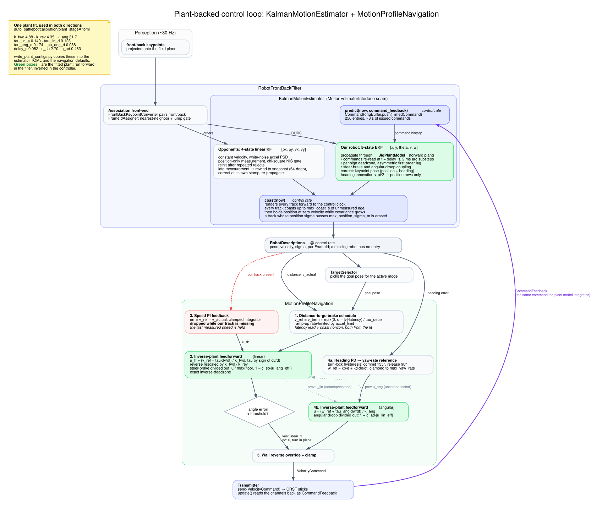

# Plant-backed control loop

`KalmanMotionEstimator` and `MotionProfileNavigation` are two halves of one loop. The
estimator runs the fitted drivetrain model forward to answer "where is our robot now";
the navigation runs the same model backward to answer "what command produces the speed I
want". Both read their numbers from the same jig fit, so a refit moves the estimator and
the controller together.



Regenerate the SVG after editing `diagrams/plant_backed_control.dot`:

```bash
./docs/generate_diagrams.sh   # needs graphviz (dot)
```

## Call pattern

`ControlLoop::run_cycle` runs at control rate, driven by `ThreadedControlLoop` (or
`SteppedControlLoop` in sim); perception arrives at about 30 Hz. The two are not in
lockstep, and the split matters:

1. `pump_input()` calls `transmitter_->update()`, which reads the RC channels back as
   `CommandFeedback`. The feedback is normalized [-1, 1] stick, the same space the command
   was sent in. Physical units never cross this boundary: whoever needs m/s and rad/s
   applies the `[plant]` gains themselves, so the drivetrain scaling is defined once. The
   EKF hands the stick command to `JigPlantModel`; the dead-reckoning arm calls
   `plant_stick_to_body_velocity()`, the same gains without the deadzones, coupling, and
   lag a single-frame hold cannot represent.
2. `robot_filter_->predict(now, command_feedback)`, every tick. Inside the estimator this
   pushes a `TimedCommand` into `CommandRingBuffer` and then calls `coast(now)`.
3. `robot_filter_->correct(...)`, only when a new perception frame landed. This runs the
   association front-end and then `MotionEstimatorInterface::update`.
4. `target_selector_->get_target(...)` picks the goal pose.
5. `navigation_->update(...)` returns a `VelocityCommand`.
6. `transmitter_->send(command)`, which is what step 1 reads back on the next tick.

## Estimator: the plant run forward

`KalmanMotionEstimator` (`src/robot_filter/kalman_motion_estimator.cpp`) sits behind the
`MotionEstimatorInterface` seam, so it swaps the state estimation strategy without
touching association.

### Opponents

Four-state linear Kalman filter, `[px, py, vx, vy]` in the field frame, constant-velocity
model with continuous white-noise acceleration. Measurements are position-only and pass a
chi-square innovation gate; `reinit_after_rejects` consecutive rejects reinitialize the
track, on the theory that a consistent reject means the world moved, not the measurement.

Perception latency puts a measurement stamp behind the control clock. Rather than folding
it in at the current state (which biases against the direction of motion), the track
rewinds to the newest of 64 snapshots at or before the measurement stamp, corrects there,
and lets the next `coast()` re-propagate.

### Our robot

Two modes, selected by `our_robot_mode`:

- `DEAD_RECKONING` integrates the last commanded velocity directly, matching
  `RobotTemporalMotionFilter`.
- `EKF` runs a five-state EKF `[x, y, theta, v, w]` propagated by `JigPlantModel`, which
  re-reads the command history at `t - delay_s` and integrates exact arcs in 2 ms
  substeps through per-sign deadzones, asymmetric first-order lag, and the steer-brake and
  angular-droop coupling terms.

Keypoint measurements correct position and heading; blob centroids correct position only.
A heading innovation past pi/2 also falls back to the position rows, because the
front/back keypoint converter can flip a robot and folding a flipped heading in would spin
the whole state.

### coast()

`coast(now)` renders every track forward to the control clock on a copy, so the emitted
state moves between perception frames instead of freezing at the last `correct()`. Our
EKF coasts up to `max_coast_s` of unmeasured age and then holds position while covariance
keeps growing. A track reads `is_stale` once it has gone 0.1 s unmeasured, which is three
frame periods at 30 Hz: normal between-frame coasting stays fresh, a real dropout does not.

## Navigation: the same plant inverted

`MotionProfileNavigation` (`src/navigation/motion_profile_navigation.cpp`) drives to the
goal and arrives at a commanded terminal velocity without overrunning. The terminal
velocity is per behavior mode, because the mode set on the dashboard decides what the mission is:
`attack_terminal_speed_fraction` ships at `1.0` so the robot drives through the opponent at full
speed, and `run_away_terminal_speed_fraction` ships at `0.0` so it arrives stopped at the safe
point. Both are a fraction of the plant's `k_fwd`, clamped to `[0, 1]`, so a refit
rescales them. A mode flip resets the trajectory
state, since the goal and the terminal speed both change at once and carrying the old
reference across would feed the feedforward a `dv/dt` step the plant never asked for.

1. **Distance-to-go brake schedule.** On a first-order plant the residual travel after
   commanding `v_term` is about `v*(tau_decel + latency)`, so the reference speed is
   capped at `v_term + max(0, d - |v|*latency) / tau_decel`. The brake point comes out of
   the measured plant instead of a hand-tuned brake distance. Ramp-up is rate-limited by
   `accel_limit`.
2. **Inverse-plant feedforward.** `u_ff = (v_ref + tau*dv/dt) / k_fwd`, with `tau`
   selected by the sign of `dv/dt` so a falling reference actually commands the brake.
   A negative command is rescaled by `k_fwd / k_rev` because reverse is the weaker
   direction. Then the steer-brake loss is divided out and the deadzone inverted exactly.
3. **Speed PI feedback** on `v_ref - v_actual`, with a clamped integrator. This is dropped
   while our track is `is_stale`: a dead-reckoned speed is a function of this controller's
   own command, so closing a loop on it is not feedback. The last measured speed is held
   through the stale stretch so the latency lead keeps working.
4. **Angular channel, same shape.** Turn-lock hysteresis (commit at 135 degrees, release
   at 90) stops the shortest-turn sign from dithering near 180. A PD on heading produces a
   yaw-rate reference, which goes through the same inverse-plant feedforward with the
   regime-appropriate yaw time constant.

Linear command only opens up once the heading error is inside `angle_threshold`;
otherwise the robot turns in place and the linear state is bled so it does not lunge when
the gate opens.

### The two coupling compensations are mutually recursive

The steer-brake term reads the turn command and the droop term reads the linear command.
Each is driven by the previous tick's **uncompensated** counterpart, which breaks the
loop. Feeding the compensated values back instead has a loop gain above 1 and saturates
both channels within a few ticks.

## One fit, two consumers

The fitted numbers live in `playground/calibration/out/plant_stageA.toml` (sessions
2026-08-19 through 2026-08-23, model M4). One C++-side copy carries them: the top-level
`[plant]` table in `config/_common.toml`, parsed into `PlantConfiguration`
(`include/plant/config.hpp`) and handed to both consumers after their own sections parse.
The estimator builds a `JigPlantModel` from it; the controller inverts the same fields for
its brake schedule and feedforward. Neither has C++ defaults, so a config with no `[plant]`
is a load error rather than a subsystem running on zeros.

`playground/calibration/write_plant_configs.py` rewrites the numeric literals in
`simulation/sim_mrs_buff_mk3.toml` and `config/_common.toml` in place, so the hand-written
notes next to each number survive. `--check` reports drift without changing anything.

Which term does what on each side:

| Fit parameter | Estimator | Navigation |
| --- | --- | --- |
| `k_fwd` 4.88002 | forward gain | divisor mapping reference speed to command |
| `k_rev` 4.3546 | reverse gain | reverse-gain rescale |
| `k_ang` 31.7062 | yaw gain | divisor mapping yaw-rate reference to command |
| `tau_lin_a` 0.14921 | spin-up lag | feedforward of `dv/dt` |
| `tau_lin_d` 0.123461 | coast lag | brake horizon, with `delay_s` |
| `tau_ang_a` 0.173867 | yaw spin-up lag | yaw feedforward, rising |
| `tau_ang_d` 0.0878998 | yaw coast lag | yaw feedforward, falling |
| `delay_s` 0.0522094 | transport delay | latency lead in the brake schedule |
| `c_sb` 2.70197 | steer-brake loss | divided back out of the forward command |
| `c_ad` 0.463423 | angular droop | only when `compensate_angular_droop` is true |

The one deliberate asymmetry is `c_ad`. The estimator models the droop because the plant
has it. The controller reads the same coefficient but ships with
`navigation.compensate_angular_droop = false`, because compensating made the controller
worse: on the 90-degree turning approach, enabling it moved terminal error from 0.008 m to
0.067 m and time-to-goal from 1.10 s to 2.83 s. Compensating buys faster heading
convergence by commanding a harder turn, and the steer-brake term charges forward speed
for exactly that. The heading loop is closed-loop already and gets there without the help.
The coefficient is measured; the compensation is a choice, which is why the switch is a
bool rather than a second copy of the number.

## Where each piece is selected

- `[plant]` in `config/_common.toml`, the shared fit both subsystems read.
- `[robot_filter.motion_estimator] type = "KalmanMotionEstimator"`, `our_robot_mode = "EKF"`
  in `config/_common.toml`.
- `[navigation] type = "MotionProfileNavigation"` in `config/_common.toml`, so every
  profile gets it by default. Mr Stabs Mk2 has no jig fit and pins `PursuitNavigation` in
  its own profiles; setting `type` there makes the merge replace the whole section, so
  those profiles spell out every pursuit field rather than inheriting any.

## Next steps

- Field-test `MotionProfileNavigation` against `PursuitNavigation` on hardware; the deltas
  so far are from sim (`docs/experiments/control_improvement/stage4_sim_report.md`).
- Pass the plant fit's acceptance criteria so production configs can move our robot off
  dead reckoning onto the EKF arm.

## Notes moved from code comments (2026-11-15)

### `playground/calibration/distill_mujoco_plant.py`

The app's EKF and MotionProfileNavigation both run JigPlantModel: first-order lag, deadzones,
delay, and steer-brake coupling, with stick commands in. The MuJoCo fit (fit_mujoco_plant.py) has
motor, contact, and inertia terms the app cannot run. This drives the fitted MuJoCo model through
ClosedLoopSim with stick tapes shaped like the velocity jig protocol (deadzone staircases, steps
with coasts, reversals, a steer/brake grid), fits the M4 grey-box model to the result the way
fit_jig_plant.py fits jig data, and scores it on random stick tapes the fit never saw.

Stick tapes go into ClosedLoopSim, which runs the firmware mixer and auto-steer, the drivetrain
delay, and command shaping. That matches what the app's plant is fed: CommandFeedback is the
transmitter's stick readback, after its slew limit and deadzone. The radio link delay is not in
ClosedLoopSim, so it comes from the sessions' clock alignment and is added to the fitted delay
afterwards. A pure shift adds exactly.

Samples after the chassis pitches more than --pitch-gate-deg off its rest pitch are dropped, and
stay dropped for the rest of that tape. The grey-box model is flat and cannot represent a wheelie
or a flip, so the table only covers the command range the robot stays down in. The report lists
which tapes lost samples.

Every restart within --loss-ratio of the best MuJoCo loss is distilled too. The spread across those
tables is the parameter spread the plan hands to the learned sim, and shows which grey-box terms
the MuJoCo data pins.

python playground/calibration/distill_mujoco_plant.py \
playground/calibration/out/mujoco_sysid/fit_<ts> \
--holdout playground/calibration/out/mujoco_sysid/s04

Writes <fit_dir>/distilled/plant.toml (the best run's [plant] table, radio delay included),
distill.json (every run's table, sim and session scores, spread, masked tapes) and
plant_steps.png (step-and-release responses and steady-state speed against stick, the distilled
table against the one the profiles carry now).

- The table the app runs today, scored alongside so the report shows what the swap buys. (at `CURRENT_TABLE = REPO_ROOT / "config" / "mr_stabs_mk2_aer_zed_box.toml"`)
- The jig fit's horizons: C1 is stated at 100 ms, C2 and C3 at 400 ms. (at `HORIZONS = (0.033, 0.066, 0.100, 0.200, 0.300, 0.400, 0.500)`)
- Mrs Buff's jig fit landed c_sb at 2.70, past PARAM_BOUNDS' 1.5, so the bound is widened rather than left to decide the answer. (at `BOUNDS = {"c_sb": (-0.5, 4.0), "c_ad": (-0.5, 2.0)}`)
- Latched: once the robot has pitched up it lands somewhere the flat model never predicted. (at `valid = np.cumsum(tilted) == 0`)
- mixer the direct grey-box fit uses. Errors in multiples of each session's noise floor.
- A stick move cannot reach the ESP32 before it is sent: a negative lag is a clock fit or stamping error (2026-10-15 measured -9.5 ms), and added to the drivetrain delay it would write a negative delay_s. (at `print(`)
- The app's delay runs from stick readback to motion: radio link plus drivetrain. (at `final = table.replace(delay_s=table.delay_s + radio)`)

### `playground/calibration/fit_jig_plant.py`

- The plan's objective horizons, plus 400 ms because that is where acceptance criteria C2 and C3 are stated and a table should measure the horizon it reports. (at `horizons = (0.033, 0.066, 0.100, 0.200, 0.300, 0.400, 0.500)`)

### `playground/calibration/fit_mrs_buff_mk3_interim_plant.py`

Mr Stabs Mk2's MuJoCo plant was fit to hand-driven sessions with AprilTags (fit_mujoco_plant.py).
Mrs Buff Mk3 has no such session, only the velocity jig's M4 grey-box fit
(playground/calibration/out/plant_stageA.toml: speeds, lags, deadzones, steer-brake and angular
droop, measured on the floor with the guard plates on). This drives the M4 model with jig-shaped
command tapes, treats its poses as measurements, and fits the MuJoCo plant to them with the same
staged CMA-ES and loss the session fit uses. M4 is flat, so this pins drive and scrub, not
tipping; with the weapon off she does not tip.

Commands are what the app sends: `DifferentialDriveProcessor` output (angular priority, the zero
deadzone), linear and angular in [-1, 1]. The radio mixes them per motor as left = linear -
angular, right = linear + angular (positive angular turns counterclockwise, the inverse
`greybox.predict` uses). Her ESCs run open loop: there is no eRPM feedback and no onboard yaw
loop, so the voltage-source actuator model is the whole command chain after the delay.

python playground/calibration/fit_mrs_buff_mk3_interim_plant.py \
--out playground/calibration/out/mujoco_sysid/mk3_interim

Writes fit.json (load_fit_params reads it), holdout.json (per-horizon errors and response
checks against M4) and fit.log.

- Capped at 0.02 s: the same contact softness applies to walls and opponents, and a softer contact lets the hull sink into them in a collision. M4 is flat, so the floor alone would happily trade stiffness away. (at `ParamSpec("solref_timeconst", 0.004, 0.02, log=True),`)
- The ESC's current limit caps acceleration. The datasheet gives 10.4 A stall at 12 V; without this term the fit pinned the rotor inertia at 3x to slow the launch. (at `ParamSpec("current_limit_a", 3.0, 40.0, log=True),`)

### `playground/calibration/make_plant_golden_fixture.py`

Steps the Python reference plant (auto_battlebot/control/plant.py, `Plant` class: zero-order-hold
command buffer, 2 ms substeps) over a scenario that exercises every term, and writes the
commands plus expected states as a C++ header. The C++ test replays the same commands
through JigPlantModel::propagate and must match: both sides are double precision with the
same substep, so the tolerance can sit at 1e-9.

The scenario covers: quiet start (zero command before the delay elapses), a forward step, a
reversal through the deadzone (decel then accel tau), a pure spin, a combined command that
drives the steer-brake factor into its zero clamp (c_sb 2.70 crosses zero at |u_ang_eff|
0.37), sub-deadzone commands, and a final coast.

Usage:
source scripts/activate_python.sh
python playground/calibration/make_plant_golden_fixture.py

Paths are resolved from the repo root, so the working directory does not matter.

### `playground/calibration/sim_stop_test.py`

The last check before a distilled [plant] table goes on the robot. The app plans its brake
schedule and feedforward from the [plant] table while the sim moves the robot with the fitted
MuJoCo model, so every error in the table shows up as a stop that lands short, overshoots, or
oscillates. Each arm is one [plant] table, and every arm drives the same goals.

Each run is the real binary (build/auto_battlebot) against kinematic_sim_server.py, headless,
one goal per run: a static "opponent" at the goal, attack mode with a zero terminal speed, so the
controller drives there and stops within stop_distance. Scored from the sim's own per-tick
trace, which is ground truth:

- stop_along_m: where the robot came to rest, along the final approach, relative to the goal.
Negative is short. Anything in [-stop_distance, +stop_distance] counts as a stop on target.
- peak_along_m: furthest past the goal it got on the way. Overshoot that it later backed out of
shows here and not in stop_along_m.
- arrive_s: first time inside stop_distance. settle_s: from then until speed stays under 0.05 m/s.
- reentries: how many times it left the stop circle again after arriving (oscillation).
- flipped: pitch left its rest value by more than 60 deg. Nothing else in the row means anything
then. The flat [plant] table cannot predict a backflip, so a flipping arm needs a lower
--max-linear-command, not a better table.

python playground/calibration/sim_stop_test.py \
--fit-file playground/calibration/out/mujoco_sysid/fit_<ts>/fit.json \
--arm current=config/mr_stabs_mk2_aer_zed_box.toml \
--arm distilled=playground/calibration/out/mujoco_sysid/fit_<ts>/distilled/plant.toml

Build first (scripts/build.sh). Runs are sequential: the C++ side has the sim port hard-coded.
Writes <out>/results.csv and one trace and log per run; --out defaults next to the fit file.

- The MuJoCo plant holds the drivetrain delay itself; the sim's own buffer is the radio part. (at `cfg["latency"]["command_ms"] = radio_ms`)
- The base config runs the RL environment's 2 ms step; the fit and its checks run at 1 ms. (at `robot["mujoco"]["timestep"] = 1e-3`)
- Same type as the base, so these merge key by key: arrive stopped at the goal. (at `nav: dict[str, Any] = {`)

### `playground/calibration/write_plant_configs.py`

The plant numbers have three homes: the fit (`playground/calibration/out/plant_stageA.toml`), the
kinematic sim (`simulation/sim_mrs_buff_mk3.toml`), and the C++ config chain's `[plant]` table
(`config/_common.toml`). Only the first is authored. They drifted apart once already, which is how
MotionProfileNavigation ended up running Mr Stabs Mk2's time constants on Mrs Buff Mk3, so this
script makes the other two derived.

The `[plant]` table is read by both the our-robot EKF and MotionProfileNavigation, so there is one
C++-side target rather than one per consumer.

It rewrites the numeric literal of each mapped field in place and touches nothing else. The
hand-written doc comments around those fields explain what each number does and why, which a
block regenerator would flatten, so they are left alone. That also means adding a field to the
fit does not automatically give it a home here: add it to the tables below and write the comment
by hand.

`--check` rewrites nothing and exits 1 if any consumer disagrees with the fit. Run it after a
refit, and in CI if the fit ever starts changing on its own.

Usage:
source scripts/activate_python.sh
python playground/calibration/write_plant_configs.py           # rewrite
python playground/calibration/write_plant_configs.py --check   # report drift, change nothing

Mr Stabs Mk2 has no jig fit. Its table comes from the MuJoCo fit through distill_mujoco_plant.py and
goes into its own profiles' [plant] tables only; its sim config keeps the MuJoCo plant, so no sim
fields are written:

python playground/calibration/write_plant_configs.py --robot mr_stabs_mk2         --fit playground/calibration/out/mujoco_sysid/fit_<ts>/distilled/plant.toml

- Every Mr Stabs Mk2 profile restates [plant] in full rather than inheriting Mrs Buff's. (at `MR_STABS_PLANT_CONFIGS = tuple(`)
- The controller inverts the plant, so it takes the same terms under its own names.  `angular_droop_coeff` is absent on purpose. The plant does droop (c_ad = 0.463) but compensating for it measured worse: on a 90-degree turning approach it took terminal error from 0.008 m to 0.067 m and time-to-goal from 1.10 s to 2.83 s, because the harder turn it commands is exactly what the steer-brake term then charges forward speed for. The controller default stays 0.0 and is not derived from the fit. `c_drift`/`c_drift_bias` are absent because model M4 disables them. The [plant] table uses the fit's own names, so this mapping is the identity. Listed explicitly so a field added to the fit does not silently skip the table. (at `PLANT_FIELDS = {`)

### `simulation/plants/kinematic.py`

- Internal integration substep. Mirrors auto_battlebot/control/plant.py. At the calibrated 31.7 rad/s top yaw rate this is 0.06 rad of rotation per substep; a whole 33 ms tick is 1.05 rad, where straight-line integration of an arc is wrong by tens of degrees of heading. (at `SUBSTEP_S = 0.002`)
- The pose is the centre of the disc. The fits behind this plant tracked the keypoint midpoint, which sits within 2 mm of the footprint centre. (at `return 0.0, 0.0`)
- Coupling multiplies the steady-state target, not the achieved speed: turning costs a fraction of the forward command's authority and driving costs a fraction of the turn's, but neither brakes a robot that is already coasting. (at `v_target *= max(0.0, 1.0 - cfg.steer_brake_coeff * abs(ac))`)
- Pose uses the velocity at the start of the substep, so the arc is exact for the v and w actually held over it. (at `next_yaw = self.yaw + self.w * dt`)
- Accel or decel is decided per channel by whether the target is further from zero than the current speed. Braking into a reversal uses the decel constant until the sign flips, as the drivetrain does: friction first, then torque. (at `tau_lin = tau_l_acc if abs(v_target) > abs(self.v) else tau_l_dec`)

