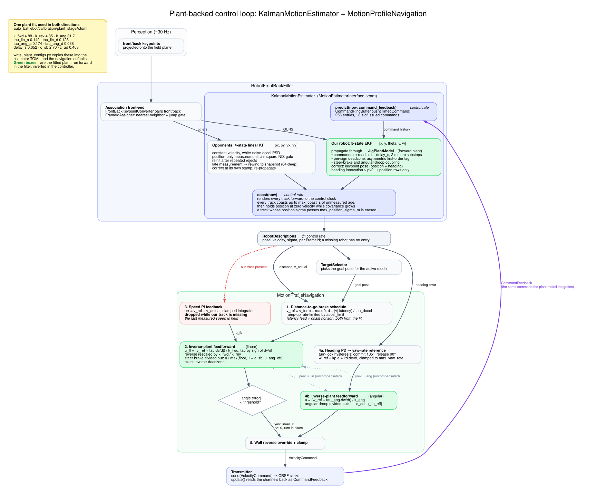

# Plant-backed control loop

`KalmanMotionEstimator` and `MotionProfileNavigation` are two halves of one loop. The
estimator runs the fitted drivetrain model forward to answer "where is our robot now";
the navigation runs the same model backward to answer "what command produces the speed I
want". Both read their numbers from the same jig fit, so a refit moves the estimator and
the controller together.



Regenerate the SVG after editing `diagrams/plant_backed_control.dot`:

```bash
./docs/generate_diagrams.sh   # needs graphviz (dot)
```

## Call pattern

`ControlLoop::run_cycle` runs at control rate, driven by `ThreadedControlLoop` (or
`SteppedControlLoop` in sim); perception arrives at about 30 Hz. The two are not in
lockstep, and the split matters:

1. `pump_input()` calls `transmitter_->update()`, which reads the RC channels back as
   `CommandFeedback`. The feedback is normalized [-1, 1] stick, the same space the command
   was sent in. Physical units never cross this boundary: whoever needs m/s and rad/s
   applies the `[plant]` gains themselves, so the drivetrain scaling is defined once. The
   EKF hands the stick command to `JigPlantModel`; the dead-reckoning arm calls
   `plant_stick_to_body_velocity()`, the same gains without the deadzones, coupling, and
   lag a single-frame hold cannot represent.
2. `robot_filter_->predict(now, command_feedback)`, every tick. Inside the estimator this
   pushes a `TimedCommand` into `CommandRingBuffer` and then calls `coast(now)`.
3. `robot_filter_->correct(...)`, only when a new perception frame landed. This runs the
   association front-end and then `MotionEstimatorInterface::update`.
4. `target_selector_->get_target(...)` picks the goal pose.
5. `navigation_->update(...)` returns a `VelocityCommand` in m/s and rad/s.
6. `command_shaper_->shape(command)` turns it into a `StickCommand`. `PlantCommandShaper`
   divides linear by `k_fwd` or `k_rev` by sign and yaw by `k_ang`, the inverse of
   `plant_stick_to_body_velocity()`, then saturates.
7. `transmitter_->send(stick)`, which is what step 1 reads back on the next tick.

## Estimator: the plant run forward

`KalmanMotionEstimator` (`src/robot_filter/kalman_motion_estimator.cpp`) sits behind the
`MotionEstimatorInterface` seam, so it swaps the state estimation strategy without
touching association.

### Opponents

Four-state linear Kalman filter, `[px, py, vx, vy]` in the field frame, constant-velocity
model with continuous white-noise acceleration. Measurements are position-only and pass a
chi-square innovation gate; `reinit_after_rejects` consecutive rejects reinitialize the
track, on the theory that a consistent reject means the world moved, not the measurement.

Perception latency puts a measurement stamp behind the control clock. Rather than folding
it in at the current state (which biases against the direction of motion), the track
rewinds to the newest of 64 snapshots at or before the measurement stamp, corrects there,
and lets the next `coast()` re-propagate.

### Our robot

A five-state EKF `[x, y, theta, v, w]` propagated by `JigPlantModel`, which re-reads the
command history at `t - delay_s` and integrates exact arcs in 2 ms substeps through
per-sign deadzones, asymmetric first-order lag, and the steer-brake and angular-droop
coupling terms.

Every measurement corrects position and heading.
A heading innovation past pi/2 also falls back to the position rows, because the
front/back keypoint converter can flip a robot and folding a flipped heading in would spin
the whole state.

### coast()

`coast(now)` renders every track forward to the control clock on a copy, so the emitted
state moves between perception frames instead of freezing at the last `correct()`. Our
EKF and the opponent filter coast up to `max_coast_s` of unmeasured age, then hold position
and report zero velocity and yaw rate while covariance keeps growing. Once a track's position
sigma passes `max_position_sigma_m` the estimator erases it, and that is the only signal that
a robot is gone.

## Navigation: the same plant inverted

`MotionProfileNavigation` (`src/navigation/motion_profile_navigation.cpp`) drives to the
goal and arrives at a commanded terminal velocity without overrunning. The terminal
velocity is per behavior mode, because the mode set on the dashboard decides what the mission is:
`attack_terminal_speed_fraction` ships at `1.0` so the robot drives through the opponent at full
speed, and `run_away_terminal_speed_fraction` ships at `0.0` so it arrives stopped at the safe
point. Both are a fraction of the plant's `k_fwd`, clamped to `[0, 1]`, so a refit
rescales them. A mode flip resets the trajectory
state, since the goal and the terminal speed both change at once and carrying the old
reference across would feed the feedforward a `dv/dt` step the plant never asked for.

1. **Distance-to-go brake schedule.** On a first-order plant the residual travel after
   commanding `v_term` is about `v*(tau_decel + latency)`, so the reference speed is
   capped at `v_term + max(0, d - |v|*latency) / tau_decel`. The brake point comes out of
   the measured plant instead of a hand-tuned brake distance. Ramp-up is rate-limited by
   `accel_limit`.
   The distance needs no latency lead of its own: the motion estimator renders every track at
   `now + plant.delay_s`, so the pose it measures from is already where the robot will be when the
   command reaches the wheels. Subtracting `v*latency` as well double-counted the travel and
   braked 10.4 cm early at 2 m/s, against the 0.15 m `stop_distance`
   (`BrakeScheduleDoesNotSubtractALatencyLead` guards it). The horizon still adds `latency_` on
   top of `tau_decel_`, which is the same argument one delay too many, since decay starts from
   the state's own time and `tau_decel_` alone is the derived value. It stays as margin.
   Dropping it takes the horizon from 0.252 s to 0.200 s and raises the reference speed 26% at
   every distance. Nothing has measured that against a stop, so change it with a field or
   replay check, not on the algebra.
2. **Inverse-plant feedforward.** `u_ff = (v_ref + tau*dv/dt) / k_fwd`, with `tau`
   selected by the sign of `dv/dt` so a falling reference actually commands the brake.
   A negative command is rescaled by `k_fwd / k_rev` because reverse is the weaker
   direction. Then the steer-brake loss is divided out and the deadzone inverted exactly.
3. **Speed PI feedback** on `v_ref - v_actual`, with a clamped integrator. `v_actual` is the
   EKF's forward speed whenever our track exists. While the track is missing the loop runs on
   the cached pose, the feedback is dropped and the last measured speed is held, so the
   latency lead keeps working.
4. **Angular channel, same shape.** Turn-lock hysteresis (commit at 135 degrees, release
   at 90) stops the shortest-turn sign from dithering near 180. A PD on heading produces a
   yaw-rate reference, which goes through the same inverse-plant feedforward with the
   regime-appropriate yaw time constant.

Linear command only opens up once the heading error is inside `angle_threshold`;
otherwise the robot turns in place and the linear state is bled so it does not lunge when
the gate opens.

### The two coupling compensations are mutually recursive

The steer-brake term reads the turn command and the droop term reads the linear command.
Each is driven by the previous tick's **uncompensated** counterpart, which breaks the
loop. Feeding the compensated values back instead has a loop gain above 1 and saturates
both channels within a few ticks.

## One fit, two consumers

The fitted numbers live in `auto_battlebot/calibration/plant_stageA.toml` (sessions
2026-08-19 through 2026-08-23, model M4). One C++-side copy carries them: the top-level
`[plant]` table in `config/robots/mrs_buff_mk3.toml`, which `config/_common.toml` loads with
`from = "robots/mrs_buff_mk3"` (`docs/reference/config/config_extends.md`). It is parsed into `PlantConfiguration`
(`include/plant/config.hpp`) and handed to both consumers after their own sections parse.
The estimator builds a `JigPlantModel` from it; the controller inverts the same fields for
its brake schedule and feedforward. Neither has C++ defaults, so a config with no `[plant]`
is a load error rather than a subsystem running on zeros.

`auto_battlebot/calibration/write_plant_configs.py` rewrites the numeric literals in
`simulation/sim_mrs_buff_mk3.toml` and `config/robots/mrs_buff_mk3.toml` in place, so the hand-written
notes next to each number survive. `--check` reports drift without changing anything.

Which term does what on each side:

| Fit parameter | Estimator | Navigation |
| --- | --- | --- |
| `k_fwd` 4.88002 | forward gain | divisor mapping reference speed to command |
| `k_rev` 4.3546 | reverse gain | reverse-gain rescale |
| `k_ang` 31.7062 | yaw gain | divisor mapping yaw-rate reference to command |
| `tau_lin_a` 0.14921 | spin-up lag | feedforward of `dv/dt` |
| `tau_lin_d` 0.123461 | coast lag | brake horizon, with `delay_s` |
| `tau_ang_a` 0.173867 | yaw spin-up lag | yaw feedforward, rising |
| `tau_ang_d` 0.0878998 | yaw coast lag | yaw feedforward, falling |
| `delay_s` 0.0522094 | transport delay | latency lead in the brake schedule |
| `c_sb` 2.70197 | steer-brake loss | divided back out of the forward command |
| `c_ad` 0.463423 | angular droop | only when `compensate_angular_droop` is true |

The one deliberate asymmetry is `c_ad`. The estimator models the droop because the plant
has it. The controller reads the same coefficient but ships with
`navigation.compensate_angular_droop = false`, because compensating made the controller
worse: on the 90-degree turning approach, enabling it moved terminal error from 0.008 m to
0.067 m and time-to-goal from 1.10 s to 2.83 s. Compensating buys faster heading
convergence by commanding a harder turn, and the steer-brake term charges forward speed
for exactly that. The heading loop is closed-loop already and gets there without the help.
The coefficient is measured; the compensation is a choice, which is why the switch is a
bool rather than a second copy of the number.

## Test plant

`mrs_buff_mk3_plant()` in `tests/plant/mrs_buff_mk3_params.hpp` returns the Mrs Buff Mk3 jig fit as a `JigPlantParams`, for tests that need a plant that behaves like the real drivetrain. It reads `plant_golden::kParam_*` from the generated golden constants instead of hand-copied numbers, so a refit moves the tests with it.

Nothing in C++ defaults to a fit, so a test that default-constructs a config gets a zero plant and has to ask for this one explicitly. Production code gets its plant from the `[plant]` config table.

## Next steps

- Pass the plant fit's acceptance criteria so production configs can move our robot off
  dead reckoning onto the EKF arm.

## Config handling

- `apply_plant` hands the shared top-level `[plant]` table to a config after `parse_fields`. It is separate from parsing because the plant is a top-level section and the config's own parser never sees it. Controllers and estimators that do not model the plant (pursuit, fixed velocity, dead reckoning) keep the no-op.
- A missing `[plant]` fails at parse time (`src/plant/config.cpp`). Every profile needs one, because the command shaper converts every navigator's m/s output to sticks with its gains. A defaulted plant would brake, feedforward and convert against a drivetrain no experiment measured. `PlantCommandShaper` also rejects a `k_fwd`, `k_rev` or `k_ang` that is not positive.

## Plant parameters

- `PlantParams` mirrors `PlantParams` in `auto_battlebot/plant.py` field for field. Values come from the jig fit (`fit_jig_plant.py`) copied into the `[plant]` table; the fit output stays the source of truth. Model structure selection happens fit-side: a ladder rung disables a term by writing it as zero, so the struct needs no ladder knowledge. Zero tau means no lag, zero delay means no delay.
- `ekf::ekf_update` is a gated Joseph-form measurement update. The innovation rows flagged in `angle_rows` are wrapped into (-pi, pi] before gating, and the state rows flagged in `angle_states` are wrapped after the update, so angular quantities never see a 2-pi discontinuity. A gate-rejected measurement leaves state and covariance untouched. `gate_nis <= 0` disables the gate. The Joseph form `(I - KH) P (I - KH)^T + K R K^T` keeps the covariance positive semidefinite where the short form `P - KHP` does not under roundoff.
- `PlantModelInterface` is the process model for the our-robot EKF: commands in, predicted state and Jacobian out. `JigPlantModel` mirrors `auto_battlebot/plant.py` exactly (deadzone, per-sign gain, transport delay, asymmetric first-order lag, arc integration with 2 ms substeps). `plant_model_` in `KalmanMotionEstimator` holds the concrete type so `coast()` can propagate a copy without paying for the finite-difference Jacobian.
- Dead-reckoning arms use the fitted gains alone (`k_fwd`, `k_rev`, `k_ang`): no deadzone removal, no steer-brake or droop coupling, no drift, no lag. They hold one command flat across a single frame and carry no state, so the coupling terms would model a response the arm cannot represent. Use `plant_steady_state()` instead when the caller integrates a command history with lag, as `JigPlantModel` does for the EKF arm. `linear_y` is always zero: a differential drive has no lateral degree of freedom and every transmitter writes zero there.
- `JigPlantModel` takes normalized [-1, 1] `StickCommand`s, `forward` and `yaw`. `lateral` is
  ignored (tank drive). The gains map to m/s and rad/s, so passing physical velocities would apply
  them twice.
- The command span must cover `[t0 - delay_s, t1]`; `CommandRingBuffer::gather` builds exactly
  that. The command is re-read every substep, zero-order held, and zero before the first entry,
  matching `Plant.command_at` in `plant.py`.
- `CommandRingBuffer` is a fixed ring of 256 `TimedCommand`s, oldest overwritten first. At 30 Hz
  that is 8 s, far past any transport delay or retrodiction window. `push()` never allocates, so
  it is safe on the control path, and it rejects a stamp older than the newest entry (returns false), so stamps never decrease: `latest_at` and `gather`
  stop at the first entry newer than the query. `latest_at(stamp)` returns the newest entry at or
  before `stamp`, or null when the buffer is empty or every entry is newer. `gather(start, end,
  out)` clears `out`, then copies, oldest first, the entry active at `start` (the newest at or
  before it, if one exists) followed by every entry in `(start, end]`. Callers reuse one scratch
  vector across ticks to avoid allocation.
- `PlantModelInterface::propagate(state, commands, t0, t1, jacobian)` takes the command history oldest first and reads it at the model's own delay offset. It writes the state-transition Jacobian d(state at t1)/d(state at t0) for covariance propagation. A history that does not cover the span is not rejected: the missing part reads as zero command, which `ZeroCommandBeforeFirstEntry` pins.
- The Jacobian is a central finite difference over the five states. The model is piecewise
  (deadzone, coupling clamp, sign-selected tau), so an analytic Jacobian would have to follow the
  branches. It stays numeric until profiling argues otherwise.
- `PlantState` is `x`, `y` in meters (field frame), `theta` in radians (field frame, wrapped to
  (-pi, pi]), `v` in m/s (body forward) and `w` in rad/s (yaw rate).
- `plant_effective_command` removes the deadzone per sign and rescales:
  `u_eff = sign(u) * max(|u| - dz, 0) / (1 - dz)`. It clips each deadzone to 0.95, as
  `effective_command` in `plant.py` does.
- `plant_steady_state` mirrors `steady_state` in `plant.py`: target body speed and yaw rate for a
  held command, coupling and drift included. It clamps the steer-brake and droop factors at zero. At the fitted `c_sb` of 2.70 the
  factor crosses zero near `|u_ang_eff|` 0.37, so the clamp is load-bearing.
- `JigPlantModel` applies the same deadzone curve forward that `plant_effective_command` applies in the controller.
- The rescale by `1/(1 - deadzone)` exists so saturation still means saturation. Without it a deadzone would cap the plant's reachable authority below 1.
- A command under `dz_ang_l` does not move the robot, so the coupling terms must not be charged for it. Half the deadzone is inside for both signs.
- `dz_ang_r` is 1.5x `dz_ang_l`, so the same command magnitude yields less effect turning right. The jig measured that asymmetry, and a symmetric deadzone would hide it.
- The coupling compensation divides by `1 - c_sb * |u_ang_eff|`. The fitted `c_sb` of 2.702 reaches zero authority at `|u_ang_eff|` 0.370. Past that the fit no longer describes the plant, so `steer_brake_floor` has to catch it: without the floor the divisor crosses zero and the command goes infinite, then flips sign.

## MotionProfileNavigation control law

Motion-profiled tracker with inverse-plant feedforward and speed feedback. For a first-order drivetrain it drives to the goal and arrives at a commanded terminal velocity without overrunning.

The terminal velocity is per behavior mode: ATTACK drives through the opponent at full speed, RUN_AWAY arrives stopped at the safe point. Both are configurable, and a mode flip resets the trajectory state because the mission changed. The config value is a fraction of the plant's `k_fwd`, clamped to [0, 1] (0 is a precise zero-velocity stop, 1 is full speed). It is normalized rather than m/s so a refit rescales it instead of leaving a hand-copied speed stale.

1. Distance-to-go velocity profile. The residual travel after commanding v_term on a first-order plant is about v * (tau_decel + latency), so the reference speed is capped at v_term + d / (tau_decel + latency): a coast-aware brake schedule derived from the measured plant, not a hand-tuned brake distance. Ramp-up is rate-limited for a clean launch.
2. Inverse-plant feedforward. Maps the reference speed (m/s) back to a normalized command by dividing by max speed, adds tau_accel * dv/dt to overcome spin-up lag, divides out the steer-brake authority the turn is costing, and applies exact inverse-deadzone.
3. Speed PID feedback. Corrects plant-model error using our filtered speed, so open-loop feedforward accuracy and disturbance rejection stay separated. The feedback is dropped while our track is stale, because a dead-reckoned speed is a function of our own command and closing a loop on it is not feedback. The last measured speed is held through stale stretches so the latency lead keeps working while the speed feedback is off.
4. Angular control in the same shape: turn-lock hysteresis, a PD on heading producing a yaw-rate reference in rad/s, then an inverse-plant feedforward through `max_angular_speed` with the regime-appropriate yaw time constant and the angular droop divided out. The yaw spin-up constant is about twice the coast constant, so the feedforward needs the sign of the reference's rate of change: a turn winding up needs extra command, and a turn stopping needs the command pulled back early or the heading sails past.

A mission reset clears the trajectory and integrator state that only makes sense within one mission: turn commitment, reference speeds, the speed integral, and the coupling history. It runs when a zero-velocity goal is reached and when the behavior mode flips. It leaves the pose and speed memory alone, since those describe the robot rather than the mission.

## Plant terms in the navigation config

- The measured drivetrain is stamped in by `apply_plant` from the shared top-level `[plant]` table rather than parsed from `[navigation]`. The controller inverts the same fit the our-robot EKF propagates, so both read one table. `k_fwd` / `k_rev` are the divisors mapping a reference speed back to a normalized command, `tau_lin_a` feedforwards dv/dt against spin-up lag, `tau_lin_d` and `delay_s` set the brake horizon, `c_sb` is the steer-brake loss the controller divides back out, and `dz_ang_l` / `dz_ang_r` turn a commanded turn into the effective turn the coupling terms are defined against.
- `steer_brake_floor`: floor on the steer-brake authority multiplier. 1/c_sb = 0.370 is where the fitted linear loss reaches zero and where the fit's own residuals say the shape stops describing the plant, so the compensation saturates there instead of extrapolating into a singularity.
- Angular control is closed in rad/s, the same shape as the linear channel. Gains are rad/s per radian, not normalized command per radian.
- Droop compensation (fit c_ad = 0.463): the plant multiplies yaw authority by (1 - c_ad * |u_lin_eff|), so the heading loop is weaker at speed than in place. It defaults OFF even though the coefficient is measured, because compensating it makes the controller worse. On the 90-degree turning approach, enabling it takes terminal error from 0.008 m to 0.067 m and time-to-goal from 1.10 s to 2.83 s. Compensating buys faster heading convergence by commanding a harder turn, and a harder turn is exactly what the steer-brake term charges forward speed for. The heading loop is closed-loop already and gets there without the help; the forward speed it spends is not refunded.
- Floor on the droop multiplier: c_ad = 0.463 never reaches zero, so the floor is a guard against a refit pushing the coefficient past 1, not a shape limit like `steer_brake_floor`.

### The coupling compensations are mutually recursive

The droop term reads the linear command and the steer-brake term reads the turn command. Each is driven by the previous tick's UNCOMPENSATED counterpart, which breaks the loop. Feeding the compensated values back instead has a loop gain above 1 and saturates both channels within a few ticks.

## Transmitter acceleration limit

`max_motor_rpm_per_sec` slew-limits the linear command so wheel surface acceleration stays below the slip and flip threshold. The measured limit is 8.5 m/s^2, which is 8.5 * 60 / (pi * 0.05) = about 3247 RPM/s for the 0.05 m wheel radius. 0 disables it, the default: no profile limits, so the plant is characterized and the RL policy trained without one.

## Per-mode terminal velocity

- The mode rides on `TargetSelection`, stamped by `ControlLoop::resolve_target`.
- Zero terminal velocity is a precise stop: at the safe point the robot holds instead of creeping through and giving the ground back. Stopping short of the opponent is the failure the ATTACK drive-through terminal velocity prevents.
- The brake schedule for a zero terminal velocity binds at 0.3 m (0.3 / 0.176 s = 1.7 m/s). A full-speed terminal velocity stays clamped at `max_linear_speed_fwd` there.
- With speed feedback disabled the command is a pure function of the reference speed, so a robot arriving at 2 m/s is commanded exactly like a stationary one at the same distance. This is how `BrakeScheduleDoesNotSubtractALatencyLead` observes the estimator's render lead.
- The fraction is of the fit, so half throttle at the goal means half of whatever `k_fwd` says. Halving `k_fwd` and doubling the fraction gives the same arrival speed.
- At the Mrs Buff Mk3 fit (`k_fwd` 4.88 m/s), the fractions 0.1, 0.3 and 0.4 ask for about 0.5, 1.5 and 2.0 m/s. `AttackTerminalSpeedFractionIsConfigurable` compares 0.1 against 0.3 at 0.1 m, where neither saturates the command. Past about 0.23 m both ask for more than the drivetrain has and the clamp hides the difference.
- Fractions outside [0, 1] are clamped: above 1 the drivetrain has nothing left, and below 0 there is no reverse arrival because the controller only drives toward the goal.
- A mode flip is a new mission, so the turn latch clears with it. The latch holds a committed turn across the 180 degree sign flip within a mission, and must not survive into the next one.

## Dead-reckoning gains

- Config loading requires the `[plant]` table in both our-robot modes, so the dead-reckoning arm gets a physical scale for a normalized stick command from the fit.
- Reverse stick selects `k_rev`, not `k_fwd`. The Mrs Buff Mk3 fit is asymmetric (4.88 forward, 4.36 reverse), so `k_fwd * u` gets every backward coast wrong.
- The dead-reckoning conversion is the gains and nothing else. It deliberately does not call `plant_steady_state()`: a single-frame hold carries no state, so deadzones and coupling would model a response the caller cannot represent.

## Drive processor wheel space

The static-friction barrier exists per wheel, not per body axis. The tank processor applies the lifted deadzone in wheel space, which is also the space those channels go out in.

