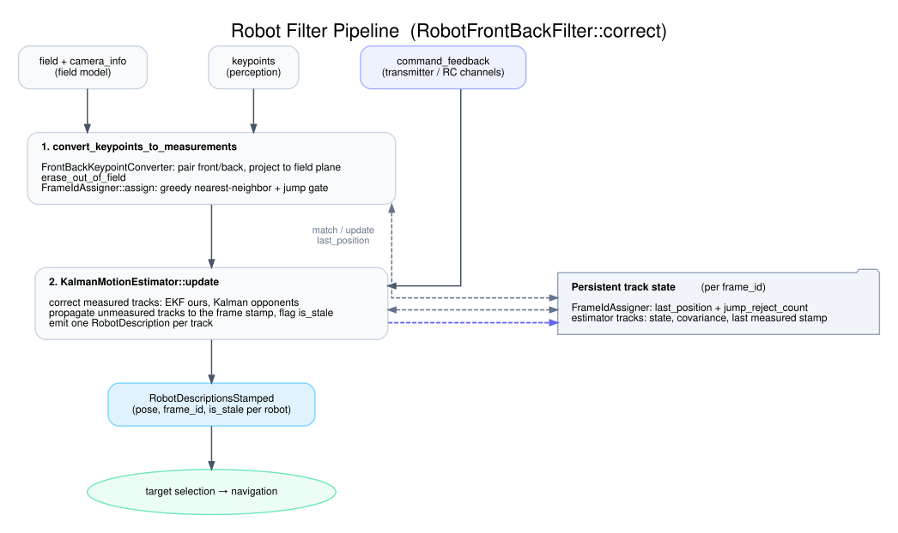

# Robot filter pipeline

The robot filter turns per-frame perception output into stable, identified robot tracks for
navigation. The active implementation is `RobotFrontBackFilter`
(`src/robot_filter/robot_front_back_filter.cpp`), selected by `[robot_filter] type` in the
TOML config.

It runs on two clocks. `correct()` runs once per perception frame with new detections.
`predict()` runs every control-loop tick, at 250 Hz, and advances tracks between frames.
Both are called from `src/control_loop/control_loop.cpp`.

How `predict()` propagates is a swappable `MotionEstimatorInterface`, chosen by
`[robot_filter.motion_estimator] type`. `DeadReckoningMotionEstimator` coasts along the
last commanded velocity and only moves our robot, which is the only one with command
feedback. `KalmanMotionEstimator` is what `config/_common.toml` selects; it coasts
opponents too, from their estimated velocity.



Regenerate the SVG after editing `diagrams/robot_filter.dot`:

```bash
./docs/generate_diagrams.sh   # needs graphviz (dot)
```

## Inputs

- `keypoints`: front/back keypoints per detected robot, from the keypoint model.
- `robot_blob_keypoints`: segmentation blob detections, a fallback when keypoints are missing.
- `YoloBboxRobotBlobModel` produces the blob detections from a plain YOLO detect engine (output
  `[1, 4 + num_classes, num_predictions]`) with no mask-prototype branch. Consumers only need box
  centers and the front/back midline, both of which come straight from the box, so dropping the
  segmentation head costs them nothing. Measurements: `docs/experiments/perception/seg_vs_bbox_2026-07-18.md`.
- `field + camera_info`: the field transform and intrinsics used to project pixels onto the field plane.
- `command_feedback`: the velocity command currently driving OUR_ROBOT_1, read back from the transmitter
  (live RC channels on hardware). Only our robot has feedback, so only our robot gets predicted.

## Sim keypoint model

`SimKeypointModel` feeds the filter from the lockstep sim instead of a detector. It builds front and back keypoints from the poses the sim's sensing model delivered (`simulation/kinematic_sim_server.py`), so the real `RobotFrontBackFilter` and `KalmanMotionEstimator` run on simulated perception: its latency, dropouts, noise and heading flips. A flipped heading arrives as swapped front and back keypoints, the way a real flip does.

- Keypoints are projected at floor height (z = 0). The sim's depth image is bare floor, so the height gate abstains on box-less detections and stamps each keypoint with the height it measured there, which is zero. Projecting at z = 0 keeps the converter's round trip exact.
- The result carries the frame's capture stamp. The tick that delivers it comes later by the sensing model's latency, which is what the filter sees on the robot.

## Stages

1. **`convert_keypoints_to_measurements`** pairs front/back keypoints per label
   (`FrontBackKeypointConverter`), projects them onto the field plane, drops out-of-field detections,
   then assigns each measurement to a `FrameId` with `FrameIdAssigner::assign`. Assignment is greedy
   nearest-neighbor against each track's last position, with a `max_jump_distance` gate that rejects
   implausible jumps (and force-accepts after `max_consecutive_jump_rejects` to recover from a bad lock).

2. **`merge_blob_detections`** adds blob detections, suppressing any that fall near an existing keypoint
   measurement so the same robot is not counted twice, and assigns leftover frame_ids.

3. **`RobotTemporalMotionFilter::update_with_prediction`** stores the measured robots, then for any
   tracked robot that was not measured this frame and has command feedback (OUR_ROBOT_1), dead-reckons
   its pose forward along the commanded velocity, clips it to the field, and flags it `is_stale`. It
   emits one `RobotDescription` per tracked robot, measured or predicted.
   An our-robot (`Group::OURS`) track unmeasured for longer than `our_robot_hold_window_s` is dropped
   from the output and forgotten instead of held. A window of 0 or below disables the decay.

## Persistent state

Three per-`FrameId` maps survive across frames:

- `FrameIdAssigner::last_position_per_frame_id_` (plus jump-reject counters): drives data association.
- `last_description_per_frame_id_`: the last full pose of each tracked robot.
- `last_timestamp_per_frame_id_`: the last time each robot appeared in the output, used only to compute
  the `dt` for dead-reckoning.

## Blob fallback and our-robot blob suppression

- A blob with a specific THEIRS label (for example `MRS_BUFF_MK1`) that cannot take its own configured `FrameId`, because a keypoint detection took it, falls back to a generic `OPPONENT` slot. The resulting `RobotDescription` is relabeled `Label::OPPONENT` so label, `frame_id`, and group stay consistent. Without the relabel, downstream consumers see a specific-model label in a generic slot, and the label flips back the next tick a proper slot frees up (an ID swap).
- `Label::OPPONENT` maps to one `FrameId` per opponent, so `initialize(2)` maps it to `{THEIR_ROBOT_1, THEIR_ROBOT_2}`. A specific label with only `{THEIR_ROBOT_1}` can have its slot taken by an `OPPONENT` keypoint while a free `OPPONENT` fallback slot remains. The fallback test relies on this.
- A fallback blob must sit apart from the keypoint detection in the image, or `is_blob_suppressed_by_keypoint` discards it before it can reach the fallback slot.
- When blobs compete for a shared slot, the highest confidence wins the global greedy assignment, whichever label the blob has.
- The blob model has no class for our robot. During a keypoint dropout, a blob on our own held position would get an opponent `FrameId` and be targeted, so the filter discards blobs within `our_keypoint_dropout_blob_radius_meters` of our last position anchor.
- The suppression is time-bounded by `our_keypoint_dropout_blob_window_s`. Once the window elapses the anchor is no longer trusted, so a genuine opponent parked where we were last seen becomes targetable again.
- Test geometry: with the fixture field transform, a blob at image row 380 sits about 0.96 m from the held pose at row 220 in the field frame, outside the default radius.

## Why prediction is load-bearing

The output `velocity` field is unused downstream (target selection and navigation read pose only). The
load-bearing path is the position prediction (indigo loop in the diagram): during a detection dropout it
both gives navigation an extrapolated pose instead of a frozen one, and advances the association
`last_position` (`set_last_position`) so the reappearing detection still matches inside the jump gate.
This helps the common short dropouts and drifts on rare long ones. The playback A/B that
measured it lived in `playground/control_stage0/`, retired in `9246cc64`; see
`docs/experiments/control/control_stage0_retired.md`.

## Control loop ownership and threading

- `ControlLoop` is the filter, target, navigation and transmit half of the pipeline, decoupled from perception. It owns the transmitter outright. Every call into the transmitter happens on whichever thread drives the cycle, so the Runner reaches it only through thread-safe request setters.
- Requests (target override, recording and mode toggles) are applied at the top of the next cycle, so the components stay single-threaded.
- `SteppedControlLoop` and `ThreadedControlLoop` decide when `run_cycle()` fires; the cycle body is identical either way. A stepped driver reads the transmitter inline, so a single-threaded run reads the transmitter before the camera grab.
- Once the threaded driver runs, the Runner reaches the transmitter only through the control loop, since the driver owns it on another thread.
- The keep-out discs published each cycle are assembled by the control loop, already inflated. The Runner cannot rebuild them because the hazard assembler holds the stale-track state.

## Python opponent filter mirror

`auto_battlebot/perception/opponent_filter.py` mirrors the `KalmanMotionEstimator` opponent arm (`src/robot_filter/kalman_motion_estimator.cpp`) for a single non-OURS track. It keeps one filter per batch row, vectorized in torch, so the same code serves the grid search over logged measurements, the parity test against the C++ golden fixture, and the RL training environment (one filter per simulated world).

- State: the 6-state model `[px, py, vx, vy, theta, omega]`. It also covers the snapshot ring and rewind, the gated position update, the ungated heading row with its flip test, reinitialization, and the render (wall stop, clip, sigmas).
- Config fields accept a float or a per-row tensor, so a grid search runs every candidate as its own row of one batch.
- `field_half_extent` is the field's half size, shape `(batch, 2)`, or `None` for no field. With no field the C++ skips the clip and the wall stop when the field size is not positive, and the mirror does the same. `margin` is `field_bounds_margin_meters`. `heading_blind_rows` is a `(batch,)` bool marking rows whose label is in `heading_blind_labels`. Wrong shapes raise `ValueError`.
- `update` takes `has_measurement` (a measurement arrived this frame), `yaw` (the measurement's rotation, 0 for a blob whose rotation is identity), `is_keypoint`, and `measurement_position_variance` (the diagonal from `measurement_noise_for`).
- A change to the C++ opponent arm lands here in the same commit. `tests/test_kalman_motion_estimator.cpp` checks the C++ side and `tests/python/test_opponent_filter.py` checks this side against the same fixture, `tests/robot_filter/opponent_filter_golden_data.hpp`. Regenerate it with `playground/opponent_prediction/make_opponent_filter_golden_fixture.py`.

## Sysid sessions as opponent-filter data

`auto_battlebot/perception/sysid_sessions.py` loads Mr Stabs Mk2 sysid sessions as opponent-filter evaluation data. The robot stands in for an opponent.

- Measurements are what the opponent path would see: the deployed YOLO pose engine's front and back keypoints on every video frame (`detect_robot_yolo.py`), projected onto the floor, decimated to the 30 Hz perception rate. They are stamped on the tag image clock (`meas_tag_clock_stamp_ns`) as an axle-centre pose in the up frame (`meas_axle_up_x`, `_y`, `_yaw`).
- The projection uses the per-session calibration the `_yolo` bundle fitted against the tag (`yolo_field_fixes.calibrate`): plane height, axle offset, video clock offset, and the size gates that drop the floor marker board.
- Ground truth is the tag-only smoother bundle (`smooth_tag_poses.py` without `--yolo`) on the smoother's 5 ms grid (`truth_5ms_grid`), same clock and frame. It never contains a YOLO fix, because scoring YOLO against a YOLO-filled bundle scores the model against itself. Loading a truth bundle whose `measurements.csv` has `source == "yolo"` rows raises `ValueError`.
- The bundle interpolates through tag dropouts, so truth is trusted only within `TRUTH_MAX_GAP_NS` of an accepted tag detection, and only while the robot is upright.

## Parallel model batch

- `ParallelModelBatch` runs the keypoint model and the robot blob model on one worker thread each. `update()` dispatches the image and blocks until both finish.
- The wait is bounded at 1 s so a hung model cannot stall the main loop. On timeout the missing model's result fields stay default-constructed (empty keypoints). A late worker drops its result when the request id has moved on.
- A worker copies the image and camera info together under `mutex_`, so the pair always belongs to the same request. The robot blob model takes only the image. All request, result and done-id fields are guarded by `mutex_`.
- The image is a shallow `cv::Mat` copy. Each worker takes its own, so the pixel buffer stays alive when `update()` times out and the caller frees its image.

## Frame and size conventions

- `RobotDescription.size` is the footprint. For labels listed in `[robot_filter.robot_size_meters_per_label]` it is the known dimensions, not the detector's box. The override is applied once, in the filter, so the keep-out, the drawn circle and the marker cube agree on robot size. The measured box is logged to the `detected_size` diagnostics channel instead: it is the only signal that the detector has started boxing a robot badly.
- `pose` is the point control tracks, our robot's axle. Hazard and clearance checks measure from the footprint centre instead, through `footprint_center()`. The offset is in the body frame (x forward, y left), in metres from `pose`, set per label from `[robot_filter.footprint_center_offset_per_label]`, and zero where the pose is the centre.
- Fiducial board layout frame: the board origin (the grid's minimum-x, minimum-y printed corner) is composed from the configured corner, offsets and orientation. The layout frame is centred on the field with the printed board's x and y and z into the floor. `compute_field` turns it into the published field frame.

## Field filters

### Calibrated filter

The match-day path. Fitting the mat outline at match time depends on segmenting a floor that has a robot on it and on the near corners being in frame, which at a cage mount they may not be. A cage measured beforehand has neither problem.

The line fit still runs at every startup, against the same frame, purely as a seating check. Nothing else can notice that the fixture did not seat or that the cage got bumped: a clamped camera has no visual odometry to disagree with. Above `max_seating_error_px` it warns and publishes the stored calibration anyway, which is the answer we trust.

### Fiducial filter

- Mode for a venue nobody has surveyed. It depends on nothing we have to segment and on no assumed mat size, so a clipped, cluttered or badly segmented outline costs it nothing.
- Put the board at a near corner. A 65 mm marker needs about 18 px of edge to decode; at the far mat corner foreshortening leaves it 8 px, and scaling the markers does not rescue that. The near corners are also the ones a cage-mounted camera cannot resolve as mat corners, so the board covers that weak spot. Numbers: `docs/experiments/perception/rgb_homography/rgb_camera_migration_2026-09-09.md`.
- Marker ids are reversed within each row (`floor_board_ids`). The physical board numbers markers right to left within a row; `cv::aruco::GridBoard` fills them left to right. Pairing them the wrong way round gives a reflection rather than a rotation, and a reflection still decodes, so everything upstream looks like it is working. It is the same class of failure as the mirrored robot tag mesh. Measured cost: `docs/experiments/perception/2026-11-15_fiducial_detector_parameters.md`.
- It replays: detection runs off `camera_data.rgb`, so a recording whose first frames contain the board carries everything needed to re-derive the field transform later. Record ten seconds with the board down before pulling it, every time.
- Gamma stretch: arena lighting is often dim enough that a raw frame decodes zero tags because marker contrast is crushed into shadow. The stretch is monotonic and per channel, so corner geometry and the recovered pose are unchanged.

### Free-roam mask model

Selects field pixels with classical heuristics instead of a segmentation model, so `PointCloudFieldFilter` can fit whatever flat surface the camera points at. Two selectors are ANDed:

- Center ROI: a centered rectangle covering `roi_fraction` of the frame (1.0 is the full frame).
- Seeded color match: the median Lab color of a small center patch is the reference and the whole frame is thresholded per channel against it. Lighting gradients and shadows mostly move L, so `tolerance_l` is set very loose while `tolerance_ab` stays tighter. Downstream RANSAC rejects same-colored non-plane pixels, so the mask only needs to be roughly right.

## Static detection gate

Suppresses robot-blob detections that hold the same field position for seconds on end. Arena floor graphics are fixed in the field frame; robots are not. Detections are tracked in field coordinates, so camera motion does not make scenery look mobile, and the ones that never move are dropped. Measurements: `docs/experiments/perception/2026-08-29_static_detection_gate.md`.

- Known cost: an immobilised opponent that stops for `min_dwell_seconds` looks like scenery and is suppressed. That is what `min_dwell_seconds` trades.
- A cluster loses its static verdict the moment an observation lands outside `static_radius_meters` of its running mean, so a robot that stops and then moves again is picked straight back up.
- A robot driving onto an already suppressed graphic widens the cluster past `static_radius_meters` and lifts suppression, so it never stays invisible. When it leaves, the graphic is suppressed again without a restart.
- Robot blobs only. Our own robot's keypoints come from a separate model and are not gated.
- The cluster statistic is the running mean distance from the cluster mean, not the maximum. Both statistics stop averaging past `responsiveness_window` and start tracking, so a robot parking on a logo can still move the verdict after thousands of frames.
- The averaging weight is capped so both statistics keep tracking instead of going numb. Below `responsiveness_window` the statistic is an exact running mean, above it an exponential one with that time constant.
- A group's field position is the centroid of its `model_results` projected onto the plane. Where the height gate supplied a measured height, the projection uses it, so a tall robot's footprint is not pushed outward by the flat-plane assumption.

## Keypoint heights

Keypoint heights correct the radial bias of flat-plane projection. Heights are per robot label with a shared default for labels without an entry. A height of 0.0 disables the correction.

`Keypoint::height_above_plane_m` is the height `KeypointHeightGate` measured from depth. It is empty when nothing measured it, and consumers then fall back to the configured per-label height. Projecting with the measured value removes the assumption that every robot stands exactly the configured height tall.
- The control loop owns the filter, target, navigation and transmit half. A threaded driver runs it on its own thread, so nothing else may touch those components after `Runner::initialize()`.

## Motion estimator seam

- `MotionEstimatorInterface` is the propagation seam inside `RobotFrontBackFilter`. It owns per-track motion state between the association front-end (keypoint conversion, blob merging, FrameId assignment) and the emitted `RobotDescriptions`. Implementations swap the state estimation strategy (dead reckoning vs Kalman) without touching association.
- Call pattern mirrors `RobotFilterInterface`: `predict()` at control rate, `update()` at perception rate, and the two are not in lockstep.
- Render lead: `coast()` renders `render_lead_s()` past `now`. Consumers steer by a state that has to describe the field when the command they are computing reaches the wheels, not when the shutter closed. 0 means render at `now`.

### Kalman arm

- Non-OURS tracks run a 6-state linear Kalman filter [px, py, vx, vy, theta, omega]: a constant-velocity translation block and an independent constant-yaw-rate heading block, each driven by its own continuous white-noise acceleration.
- Keypoint measurements correct position and heading, blob centroids position only. Position is chi-square gated, with reinitialization after repeated rejects.
- A heading more than pi/2 off the track is a front/back flip and corrects nothing; a run of flips re-initializes the heading block.
- Unmeasured tracks predict forward with growing covariance up to `max_coast_s` of track age, then hold position and heading. The opponent horizon is `opponent_max_coast_s` (`docs/experiments/control/2026-10-15_opponent_max_coast.md`).
- Measurements older than the track state (perception latency) rewind to a stored snapshot, correct at the measurement's own stamp, and re-propagate.
- The Python mirror in `auto_battlebot/perception/opponent_filter.py` must change with this arm. `tests/test_kalman_motion_estimator.cpp` holds the two to a golden fixture.
- Our-robot track has two modes. `DEAD_RECKONING` applies the last commanded velocity directly, matching `DeadReckoningMotionEstimator`. `EKF` runs a 5-state EKF [x, y, theta, v, w] propagated through `JigPlantModel` with the issued-command history (normalized stick space, from `CommandFeedback::stick_commands`) read at t - delay, corrected by keypoint poses (position and heading) or blob centroids (position only). A heading innovation past pi/2 falls back to the position rows, because the front/back keypoint converter can flip and folding a flipped heading in would spin the whole state.
- `coast()` renders every track advanced to the control-loop clock plus `render_lead_s()`, so the emitted state moves between perception frames instead of freezing at the last `correct()`.
- Rewind history: 64 snapshots. At the 250 Hz control rate that is roughly 240 ms, because `coast()` commits an opponent snapshot every tick and a 30 Hz frame burns about nine slots. It covers the measured 63 ms perception latency with room to spare; `num_rewind_missed` reports when it does not.
- Clock gaps: a single propagation step longer than `kMaxIntegrationStepS` (1.0 s) freezes position, because a clock gap that large is not motion to integrate. Covariance still grows, capped at that step.
- Estimator config: `opponent_max_coast_s` and `max_coast_s` defaults. `max_coast_s` sits at the measured p90 to p95 of perception dropout gaps; predicting multi-second gaps with a short-horizon model is fiction.
- Plant fit status: the plant fit has not passed acceptance (heading misses by 4x at the 400 ms coast horizon), so production configs stay on `DEAD_RECKONING`. Sim and playback experiments opt in through the extends chain.
- With the filter configuration `tests/test_control_loop.cpp` builds, `RobotFrontBackFilter` only propagates inside `correct()`. A control cycle with no new measurement leaves stale track poses untouched, which `ControlLoopTest.MeasurementIsCorrectedExactlyOnce` asserts with exact equality. A filter that predicted every cycle would fail that test for an unrelated reason.
- Covariance consistency: `EkfMathTest.NeesConsistencyMonteCarloConstantVelocity` simulates a constant-velocity system with known Q and R over 100 Monte Carlo runs of 60 steps and checks that the mean NEES lands inside the chi-square band for the state dimension (4 DOF, asserted band 3.5 to 4.5). NEES is the check instead of RMSE because a filter with a wrong covariance fails it regardless of how small its error looks. The band is wider than the iid chi-square interval because samples within a run are correlated step to step.
- Plant table required: every motion estimator needs the top-level `[plant]` table, because the stick-to-velocity scaling is the fit. `DEAD_RECKONING` needs it as much as `EKF`, since both arms scale sticks through the plant. A missing table is a config error, not a zero plant that freezes every prediction without saying so.
- Every plant field is required. Dropping `delay_s` makes the parse refuse instead of defaulting a fitted physical parameter to zero. Pinned by `ConfigTest.RobotFilterMotionEstimatorPlantMissingFieldThrows`, `ConfigTest.DeadReckoningMotionEstimatorWithoutPlantTableThrows` and `ConfigTest.KalmanMotionEstimatorDeadReckoningModeRequiresPlantTable`.

- Heading flip test: it only means something while the heading's own 2-sigma is inside pi/2, so it runs only while the theta variance is below `kFlipTestMaxVariance` (pi/4 squared). Past that, a measurement more than pi/2 away is as likely a turn the track did not see as a flip.
- Process noise covers the whole step, held or not. Time passing without measurements is uncertainty whether or not the pose may move.
- The initial yaw-rate sigma is `k_ang`, the full-stick yaw rate. The fitted gain is the scale of what the drivetrain can be doing while unobserved.
- Our-robot heading diagnostics record the state and the innovation of a rejected keypoint yaw. The motion profile brakes on heading, and a rejected yaw leaves theta running on the plant model alone, so without both sides a diverged theta looks like a bad measurement.
- Our-robot speed measurement: forward speed differenced against an earlier accepted pose, because the state's v row is otherwise unobserved and tracks the plant model rather than the robot. It is attempted only alongside an accepted heading, since the difference has to be projected onto a direction. Its noise is independent position noise at both ends, propagated through the divide and held above a floor for the common-mode part.
- The speed reference pose moves only once its baseline has been spent, or when there is none. Advancing it every frame would pin the baseline at one frame and put the speed row back in the noise it was widened to escape.
- Render target: `now + render_lead_s()`. `now` is already past the frame stamp by the perception latency, and a command computed from this render bites another `plant.delay_s` later. Rendering at `now + delay_s` puts every track where it will be when the command lands, which is the state target selection and navigation must steer by. The extra span is not extrapolation into unknown commands: `JigPlantModel` reads each substep's command at `t - delay_s`, so integrating to `now + delay_s` consumes exactly the commands already issued up to `now`.
- `min_coast_span_s` diagnostic: the smallest span any track is propagated over, sent out in `update()`'s diagnostics. A span past `kMaxIntegrationStepS` short-circuits to hold position, and a non-positive span propagates nothing. Both emit an estimate frozen at the shutter that looks like a healthy filter that is not moving, and both mean the control clock and frame stamps are on different timelines, which SVO playback does under `SystemClock`. It is not the render lead: opponent tracks commit every control tick and report one tick, while the our-robot track commits only in `update()` and reports a whole frame period plus the lead.
- `coast()` renders our-robot tracks on a copy, like the dead-reckoning arm. The committed state advances only in `update()`, so measurements always fold in at or after the track stamp and the our-robot arm needs no snapshot rewind. `propagate_unwrapped` skips the finite-difference Jacobian (10 extra plant integrations) that a covariance-free render never uses.

## Time

`ClockInterface` is logical (control) time in seconds: derivative terms, prediction horizons and message stamps. Wall-clock time for profiling, loop pacing and hardware timeouts must keep using `std::chrono` directly. The Runner sets the clock from the camera frame timestamp each tick (see `ManualClock`), so one source of time drives the whole pipeline and sim and playback runs are deterministic.

## Fiducial accumulation window

The Runner keeps the mask model running for 60 frames (one second at 60 Hz) on a field-filter request. That is long enough for a fiducial board to accumulate and short enough that a request with no board in frame stops running the mask model.

## Height gate

The gate measures relief (the median height of the box's inscribed circle over the median of a surrounding ring), plus a ceiling on absolute height above the fitted plane.

- Relief, not absolute height, decides flatness: if the fitted plane has drifted or the whole area sits above it, a flat graphic there is still flat and goes.
- The ceiling uses absolute height because relief alone admits walls and people. A metre off the floor is not a robot.
- Blob keypoints sit at the ends of the box midline, which land on the floor beside a robot. Sampling the inscribed circle reads the robot where sampling at the keypoints reads the floor.
- A missing depth frame abstains instead of dropping detections, so a dropped frame never blinds the pipeline. A model that produces no boxes cannot be gated, only annotated.
- A group survives whole. One keypoint over a hole in the depth map still measures from its partner, and both keep the group height, because a half-dropped front/back pair is useless downstream.
- `ModelResultStamped::boxes` is indexed by `Keypoint::detection_index`. It is empty for models that produce no boxes. It has an entry for every detection, including ones that yielded no keypoints, so the index stays aligned with what the detector emitted and `box_for` returns the right detection's box.
- Test fixture: the field transform puts the plane 3 m down the optical axis with the normal parallel to it, so keypoint height is exactly `3.0 - depth` at every pixel. Fixture boxes are the keypoint bounding rectangle inflated by a pad so the inscribed circle covers the midline like a real detection box.

## Opponent filter test scenarios

- The opponent Kalman arm is pinned explicitly in tests because the config default is HOLD, which pins every opponent at its last measured pose.
- The control loop runs ahead of the camera: a track coasts to last_t + 50 ms, then a measurement stamped at last_t + 33 ms arrives. This is the rewind case.
- After a 1 s unseen stretch the heading prior is wider than the flip test, so a measurement 120 degrees off is a turn the track missed, and the first one is taken.
- Heading tests use straight-line translation with an independent constant yaw rate, which is exactly the filter's model, so tolerances can be tight.
- The our-robot arc test command (v about 1.3 m/s, w about 0.95 rad/s under the Stage A gains) is a gentle arc.

## Ground-truth filter velocity

`GroundTruthRobotFilter` derives field-frame velocity from the pose delta since the last frame. Consumers that close a loop on speed (`MotionProfileNavigation`) read velocity instead of differencing poses, because only the filter knows whether a pose is a fresh measurement or a propagated one.

## Sensing model timing

`auto_battlebot/perception/sensing_model.py` `MeasurementModel` is the batched stand-in for the
camera and detector in the sims. Call `reset` for a new episode, then `step` once per simulation
tick with the current time. A frame is captured on the first step at or after each frame time,
stamped with that step's time (truth is known only at step times), and delivered on the first step
at least `latency` later. A step interval longer than the shortest frame period raises, so each
step captures at most one frame and delivers at most one.

The `frame_rate_hz` argument fixes the frame rate, overriding the sensing file's nominal value and
its randomization range. The lockstep sim and the kinematic sim server pass their tick rate,
since they capture one frame per tick.

The sensing file's `dropout.enabled` is true by default. False delivers every captured frame, so the robot never drops out.


## Our-robot dropout blob drop

`suppress_blobs_near_our_anchor` removes blobs within `our_keypoint_dropout_blob_radius_meters_` of our robot's held pose while no `OUR_ROBOT_1` keypoint measurement exists this frame. The blob model has no class for our robot, so such a blob would be assigned an opponent FrameId at our own location and navigation would steer into it. It does nothing when our keypoint is present (`is_blob_suppressed_by_keypoint` covers that case) or when the anchor is stale. It returns the number of blobs removed.

## Ground-truth filter slots

- A non-finite pose in a ground-truth slot means the sim did not observe the robot on this frame. The filter emits a held pose flagged stale. A slot never observed emits nothing, because inventing a pose would hand consumers a fabricated position.
- Velocity is the pose delta since the last measurement, divided by the measured-to-measured interval. Dividing a dropout-spanning delta by one frame interval would scale the velocity by the number of frames missed. The first measurement and an unusable interval give zero.
- The last measurement and its stamp are never written by the coast branch, so a returning frame differences against real data and not against the pose the coast just propagated.

## Robot descriptions cache view

The resolved robot set is a non-owning view. `robots` references either the `current` argument passed to `resolve()` or the cache's internal `previous_` snapshot. It stays valid until the next `resolve()` or `reset()`, and for the `current` branch also for the lifetime of the caller's argument.

## Workarounds

- **`fit_sensing_model.py` repeated measurements.** `drop_repeated_measurements` keeps a row only when its stamp is more than 10 ms after the previous one. The same measurement can be logged on two consecutive diagnostics messages.
