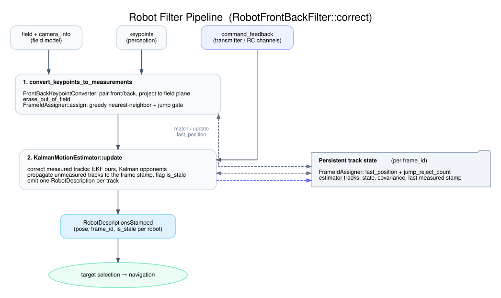

# Robot filter pipeline

The robot filter turns per-frame perception output into stable, identified robot tracks for
navigation. The active implementation is `RobotFrontBackFilter`
(`src/robot_filter/robot_front_back_filter.cpp`), selected by `[robot_filter] type` in the
TOML config.

It runs on two clocks. `correct()` runs once per perception frame with new detections.
`predict()` runs every control-loop tick, at 250 Hz, and advances tracks between frames.
Both are called from `src/control_loop/control_loop.cpp`.

How `predict()` propagates is a swappable `MotionEstimatorInterface`, chosen by
`[robot_filter.motion_estimator] type`. `DeadReckoningMotionEstimator` coasts along the
last commanded velocity and only moves our robot, which is the only one with command
feedback. `KalmanMotionEstimator` is what `config/_common.toml` selects; it coasts
opponents too, from their estimated velocity.



Regenerate the SVG after editing `diagrams/robot_filter.dot`:

```bash
./docs/generate_diagrams.sh   # needs graphviz (dot)
```

## Inputs

- `keypoints`: front/back keypoints per detected robot, from the keypoint model.
- `robot_blob_keypoints`: segmentation blob detections, a fallback when keypoints are missing.
- `field + camera_info`: the field transform and intrinsics used to project pixels onto the field plane.
- `command_feedback`: the velocity command currently driving OUR_ROBOT_1, read back from the transmitter
  (live RC channels on hardware). Only our robot has feedback, so only our robot gets predicted.

## Stages

1. **`convert_keypoints_to_measurements`** pairs front/back keypoints per label
   (`FrontBackKeypointConverter`), projects them onto the field plane, drops out-of-field detections,
   then assigns each measurement to a `FrameId` with `FrameIdAssigner::assign`. Assignment is greedy
   nearest-neighbor against each track's last position, with a `max_jump_distance` gate that rejects
   implausible jumps (and force-accepts after `max_consecutive_jump_rejects` to recover from a bad lock).

2. **`merge_blob_detections`** adds blob detections, suppressing any that fall near an existing keypoint
   measurement so the same robot is not counted twice, and assigns leftover frame_ids.

3. **`RobotTemporalMotionFilter::update_with_prediction`** stores the measured robots, then for any
   tracked robot that was not measured this frame and has command feedback (OUR_ROBOT_1), dead-reckons
   its pose forward along the commanded velocity, clips it to the field, and flags it `is_stale`. It
   emits one `RobotDescription` per tracked robot, measured or predicted.

## Persistent state

Three per-`FrameId` maps survive across frames:

- `FrameIdAssigner::last_position_per_frame_id_` (plus jump-reject counters): drives data association.
- `last_description_per_frame_id_`: the last full pose of each tracked robot.
- `last_timestamp_per_frame_id_`: the last time each robot appeared in the output, used only to compute
  the `dt` for dead-reckoning.

## Why prediction is load-bearing

The output `velocity` field is unused downstream (target selection and navigation read pose only). The
load-bearing path is the position prediction (indigo loop in the diagram): during a detection dropout it
both gives navigation an extrapolated pose instead of a frozen one, and advances the association
`last_position` (`set_last_position`) so the reappearing detection still matches inside the jump gate.
This helps the common short dropouts and drifts on rare long ones. The playback A/B that
measured it lived in `playground/control_stage0/`, retired in `9246cc64`; see
`docs/experiments/control_improvement/control_stage0_retired.md`.

## Notes moved from `src/` comments (2026-11-15)

Each entry names the file and the code it described.

### `src/keypoint_filter/static_gate.cpp`

Beside `const double weight =`:

Cap the averaging weight so both statistics keep tracking instead of going numb. Below the window this is an exact running mean; above it, an exponential one with that time constant.

### `src/keypoint_filter/static_gate.cpp`

Beside `Eigen::Vector3d sum = Eigen::Vector3d::Zero();`:

The group's field position is the centroid of its model_results projected onto the plane. Using the measured height where the height gate supplied one keeps a tall robot's footprint from being pushed outward by the flat-plane assumption.

### `src/main.cpp`

Beside `auto hazard_assembler = make_hazard_assembler(*class_config.field_filter, clock);`:

The control loop owns the filter/target/navigation/transmit half. A threaded driver runs it on its own thread, so nothing else may touch those components after Runner::initialize().

### `src/robot_filter/ground_truth_robot_filter.cpp`

Beside `const double now = result.header.stamp;`:

Field-frame velocity from the pose delta since the last frame. Consumers that close a loop on speed (MotionProfileNavigation) read velocity rather than differencing poses themselves, because only the filter knows whether a pose is a fresh measurement or a propagated one.

### `src/robot_filter/kalman_motion_estimator.cpp`

Beside `constexpr double kFlipTestMaxVariance = (M_PI / 4.0) * (M_PI / 4.0);`:

The flip test only means something while the heading's own 2-sigma is inside its pi/2: past that, a measurement more than pi/2 away is as likely a turn the track did not see as a flip.

### `src/robot_filter/kalman_motion_estimator.cpp`

Beside `ekf::propagate_covariance<5>(track.covariance, jacobian,`:

Process noise covers the whole step, held or not: time passing without measurements is uncertainty regardless of whether the pose is allowed to move.

### `src/robot_filter/kalman_motion_estimator.cpp`

Beside `track.covariance(4, 4) = config_.plant->k_ang * config_.plant->k_ang;`:

Full-stick yaw rate as the initial yaw-rate sigma: the fitted gain is the scale of what the drivetrain can be doing while unobserved.

### `src/robot_filter/kalman_motion_estimator.cpp`

Beside `if (!input.keypoints.empty()) {`:

Heading is the input the motion profile brakes on: a rejected keypoint yaw leaves theta running on the plant model alone, so record the state and the innovation that was thrown away. Without both sides here a diverged theta is indistinguishable from a bad measurement.

### `src/robot_filter/kalman_motion_estimator.cpp`

Beside `double speed_measurement = 0.0;`:

Forward speed differenced against an earlier accepted pose. The state's v row is otherwise unobserved, so it tracks the plant model rather than the robot, and the motion profile brakes on that number. Only attempted alongside an accepted heading: the difference has to be projected onto a direction, and a rejected yaw is not one.

### `src/robot_filter/kalman_motion_estimator.cpp`

Beside `const double floor_var =`:

Independent position noise at both ends, propagated through the divide, held above a floor for the part that is common-mode.

### `src/robot_filter/kalman_motion_estimator.cpp`

Beside `if (has_speed || !track.has_speed_ref) {`:

Only move the reference once its baseline has been spent, or when there is none to spend. Advancing every frame would pin the baseline at one frame and put the speed row back in the noise it was widened to escape.

### `src/robot_filter/kalman_motion_estimator.cpp`

Beside `const double target = now + render_lead_s();`:

Two lags separate the shutter from the wheels, and the render has to cover both. `now` is already past the frame stamp by the perception latency, and a command computed from this render bites another plant.delay_s later. Rendering at `now + delay_s` puts every track where it will be when the command lands, which is the only state target selection and navigation can steer by without aiming at the past. The extra span is not extrapolation into unknown commands: JigPlantModel reads each substep's command at t - delay_s, so integrating to now + delay_s consumes exactly the commands already issued up to `now`, the ones in flight.

### `src/robot_filter/kalman_motion_estimator.cpp`

Beside `double worst_span = std::numeric_limits<double>::infinity();`:

The smallest span any track is propagated over. Both failure modes below emit an estimate frozen at the shutter while looking exactly like a healthy filter that is not moving, so this is worth naming rather than inferring: a span past kMaxIntegrationStepS short-circuits to "hold position", and a non-positive span propagates nothing at all. Both mean the control clock and the frame stamps are not on the same timeline, which is what SVO playback does under SystemClock. The minimum is the right reducer for that question, and it goes out in update()'s diagnostics so a recording answers "did anything propagate, and by how much" without needing a rebuild. It is not the render lead: opponent tracks commit every control tick and so report one tick, while the our-robot track only commits in update() and so reports a whole frame period plus the lead.

### `src/robot_filter/kalman_motion_estimator.cpp`

Beside `for (const auto &[frame_id, track] : our_ekf_tracks_) {`:

Rendered on a copy, like the dead-reckoning arm: the committed state only advances in update(), so measurements always fold in at or after the track stamp and the our-robot arm needs no snapshot rewind. propagate_unwrapped skips the finite-difference Jacobian (10 extra plant integrations) that a covariance-free render never uses.
